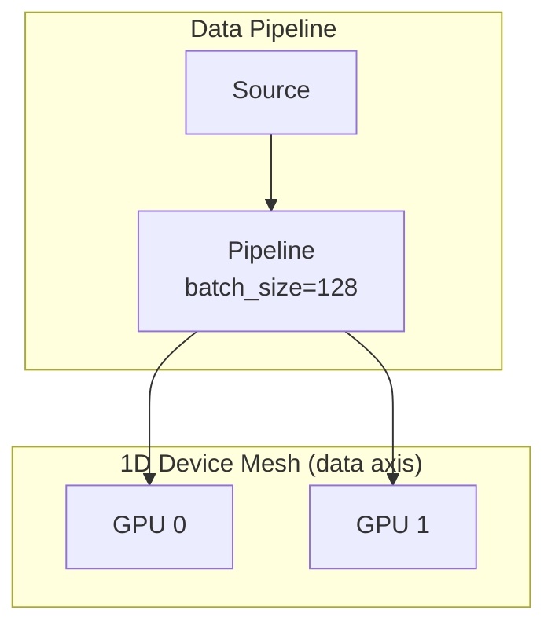
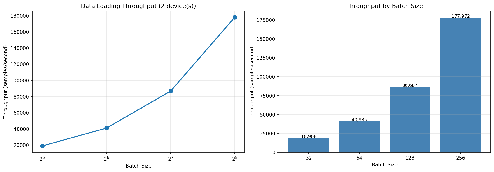
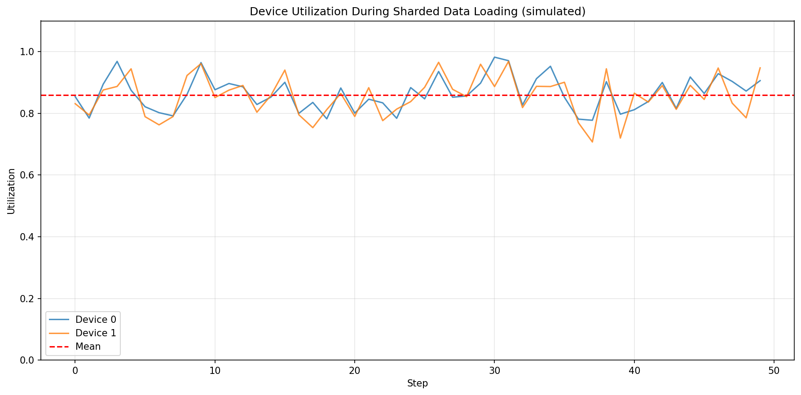
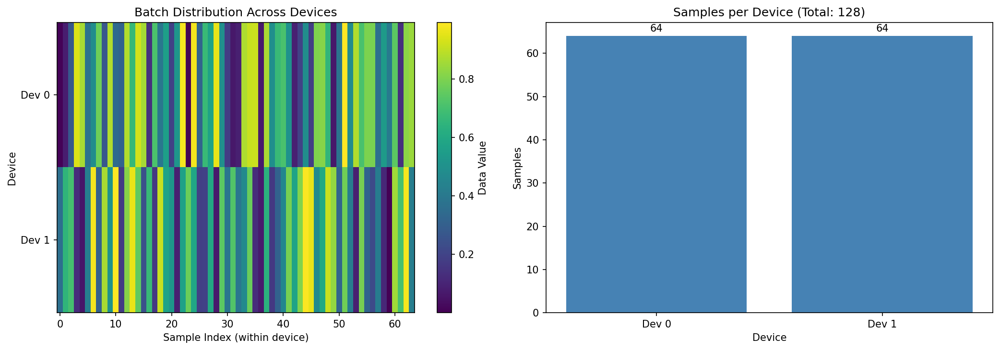

# Distributed Data Loading with Sharding Guide

| Metadata | Value |
|----------|-------|
| **Level** | Advanced |
| **Runtime** | ~45 min |
| **Prerequisites** | Sharding Quick Reference, JAX device placement |
| **Format** | Python + Jupyter |
| **Memory** | ~2 GB RAM per device |

## Overview

This in-depth guide covers distributed data loading patterns for
multi-device JAX setups. You'll learn to shard data across GPUs/TPUs,
optimize throughput for distributed training, and handle common pitfalls.

## What You'll Learn

1. Design data parallelism strategies for different device topologies
2. Implement efficient sharded batch distribution
3. Profile and optimize distributed data loading
4. Size a batch for the device count, and read an evaluation's short final batch
5. Integrate sharded pipelines with distributed training

## Coming from PyTorch?

| PyTorch | Datarax |
|---------|---------|
| `DistributedDataParallel(model)` | Model run under `jax.set_mesh(mesh)` |
| `DistributedSampler` | Data sharded via `PartitionSpec` |
| `torch.distributed.all_reduce()` | JAX handles via GSPMD |
| `world_size`, `rank` | `mesh.axis_size`, device position |

**Key difference:** JAX's GSPMD provides automatic communication insertion based on sharding annotations.

## Coming from TensorFlow?

| TensorFlow | Datarax |
|------------|---------|
| `tf.distribute.MirroredStrategy` | `Mesh` with data axis |
| `experimental_distribute_dataset` | `Pipeline(..., sharding=sharding)` |
| `strategy.scope()` | `jax.set_mesh(mesh)` |
| `tf.distribute.Strategy.run()` | `jax.jit` + sharding |

## Files

- **Python Script**: [`examples/advanced/distributed/02_sharding_guide.py`](https://github.com/avitai/datarax/blob/main/examples/advanced/distributed/02_sharding_guide.py)
- **Jupyter Notebook**: [`examples/advanced/distributed/02_sharding_guide.ipynb`](https://github.com/avitai/datarax/blob/main/examples/advanced/distributed/02_sharding_guide.ipynb)

## Quick Start

```bash
# Prepare the example datasets once as ArrayRecord (in its own process: it imports
# TensorFlow; the example reads them without it)
python scripts/prepare_example_datasets.py

python examples/advanced/distributed/02_sharding_guide.py
```

## Architecture



## Part 1: Understanding Data Parallelism

### Sharding Dimensions

| Dimension | Typical Sharding | Purpose |
|-----------|------------------|---------|
| Batch | Sharded across devices | Data parallelism |
| Height/Width | Replicated | Full image on each device |
| Channels | Replicated | Full features on each device |

### Partition Specs

```python
from jax.sharding import PartitionSpec as P

# Common partition specs
batch_sharded = P("data", None, None, None)  # (batch, H, W, C)
replicated = P(None, None, None, None)       # Full replication
model_sharded = P(None, None, None, "model") # Model parallelism
```

## Part 2: Creating the Device Mesh

The guide builds a **1D mesh** for pure data parallelism, all devices along a single `"data"`
axis. The terminal output and figures on this page are from a run on two GPUs (2x NVIDIA
A100-SXM4-80GB); on one device the script builds no mesh and its pipelines place batches on the
default device:

```python
# Device configuration
devices = jax.devices()
num_devices = len(devices)
use_sharding = num_devices >= 2

print(f"Available devices: {num_devices}")
print(f"Device types: {[str(d.device_kind) for d in devices]}")

if use_sharding:
    # Create 1D mesh for pure data parallelism
    mesh = DeviceMeshManager.create_data_parallel_mesh()
    print(f"\nCreated mesh: {mesh.shape} with axis 'data'")
else:
    mesh = None
    print("\nSingle device mode - will simulate sharding concepts")
```

**Terminal Output:**
```
Available devices: 2
Device types: ['NVIDIA A100-SXM4-80GB', 'NVIDIA A100-SXM4-80GB']

Created mesh: OrderedDict({'data': 2}) with axis 'data'
```

!!! note "Conceptual extension: 2D meshes"
    A **2D mesh** combines data and model parallelism for large models. This
    guide does not use it; the snippet below only illustrates the pattern:

    ```python
    # Conceptual only, not exercised by this guide
    if len(devices) >= 4:
        mesh_2d = DeviceMeshManager.create_device_mesh({"data": 2, "model": 2}, devices)
    ```

## Part 3: Sharded Batch Distribution

substrax builds the data-parallel sharding: the first (batch) dimension of every array is split
across the `"data"` axis and the rest is replicated. A pipeline's `sharding` names the rows of its
batches only:

```python
batch_sharding = None if mesh is None else create_data_parallel_sharding(mesh)
print(f"Batch sharding: {batch_sharding}")
```

**Terminal Output:**
```
Batch sharding: NamedSharding(mesh=Mesh('data': 2, axis_types=(Auto,)), spec=P('data',), memory_kind=device)
```

The pipeline is a standard Datarax pipeline with a preprocessing stage. Its `sharding` places
every batch on the mesh, so the preprocessing runs on each device's share:

```python
BATCH_SIZE = 128  # Total batch size across all devices; the device count must divide it
NUM_SAMPLES = 2048


def create_pipeline(batch_size=BATCH_SIZE, num_samples=NUM_SAMPLES, sharding=batch_sharding):
    """Create CIFAR-10 data pipeline, its batches placed by ``sharding``."""
    config = TFDSEagerConfig(
        name="cifar10",
        split=f"train[:{num_samples}]",
    )

    source = TFDSEagerSource(config)

    preprocessor = ElementOperator(
        ElementOperatorConfig(stochastic=False),
        fn=preprocess_image,
        rngs=nnx.Rngs(0),
    )

    return Pipeline(
        source=source,
        stages=[preprocessor],
        batch_size=batch_size,
        rngs=nnx.Rngs(0),
        shuffle=True,
        sharding=sharding,
    )
```

The first batch arrives placed on the mesh:

```python
# Test distribution
test_batch = next(iter(pipeline))
print("\nDistributed batch:")
print(f"  Image shape: {test_batch['image'].shape}")
print(f"  Image sharding: {test_batch['image'].sharding}")
```

**Terminal Output:**
```
Distributed batch:
  Image shape: (128, 32, 32, 3)
  Image sharding: NamedSharding(mesh=Mesh('data': 2, axis_types=(Auto,)), spec=P('data',), memory_kind=device)
```

### Batch Size and the Final Batch

A batch size the row axes cannot split is refused when the pipeline is built: a full batch that
does not divide is a wrong batch size. An evaluation whose length the batch size does not divide
ends on a short batch, which the pipeline places whole on every device, so every record is
evaluated once with no padding:

```python
if mesh is not None:
    try:
        create_pipeline(batch_size=BATCH_SIZE + 1)
    except ValueError as error:
        print(f"Refused: {error}")

evaluation = create_pipeline(num_samples=BATCH_SIZE * 2 + BATCH_SIZE // 2)
final_batch = list(evaluation)[-1]
print(f"Final batch: {final_batch['image'].shape[0]} rows")
print(f"  Image sharding: {final_batch['image'].sharding}")
```

**Terminal Output:**
```
Refused: batch_size 129 does not split over P('data',) on mesh {'data': 2}: use a multiple of the devices on the row axes
Final batch: 64 rows
  Image sharding: NamedSharding(mesh=Mesh('data': 2, axis_types=(Auto,)), spec=P(), memory_kind=device)
```

## Part 4: Optimizing Throughput

The guide benchmarks throughput across a sweep of batch sizes. Each run warms
up once, then times how quickly the placed batches become ready:

```python
def benchmark_pipeline(batch_size, num_batches=20, mesh=None):
    """Benchmark pipeline throughput."""
    sharding = None if mesh is None else create_data_parallel_sharding(mesh)
    pipeline = create_pipeline(
        batch_size=batch_size, num_samples=batch_size * num_batches, sharding=sharding
    )

    # Warmup
    _ = next(iter(pipeline))["image"].block_until_ready()

    # Benchmark
    pipeline = create_pipeline(
        batch_size=batch_size, num_samples=batch_size * num_batches, sharding=sharding
    )

    start = time.time()
    samples = 0
    for batch in pipeline:
        _ = batch["image"].block_until_ready()
        samples += batch["image"].shape[0]

    elapsed = time.time() - start
    return samples / elapsed


# Sweep batch sizes
batch_sizes = [32, 64, 128, 256]
for bs in batch_sizes:
    tp = benchmark_pipeline(bs, mesh=mesh)
    print(f"  Batch size {bs}: {tp:.0f} samples/s")
```

Throughput rises with batch size, from 18,908 samples/s at 32 to 177,972 at 256 on the two A100s:



*Data-loading throughput across batch sizes 32, 64, 128, and 256. Absolute
numbers depend on your device count and hardware.*

## Part 5: Device Utilization

The guide also simulates device utilization during sharded data loading to
illustrate how work spreads across devices:



*Simulated per-device utilization over the loading steps, with the mean marked.*

## Part 6: Batch Distribution

Finally, it visualizes how a single batch is split across devices:



*Left: batch samples distributed across devices. Right: samples per device for a
total batch of 128.*

## Results Summary

### Sharding Strategies

| Strategy | Use Case | Mesh Shape |
|----------|----------|------------|
| Pure Data Parallel | Most common | (N,) "data" |
| 2D Data + Model | Large models | (D, M) "data", "model" |
| Pipeline Parallel | Very long sequences | (P,) "pipeline" |

### Performance Guidelines

| Batch Size | Recommendation |
|------------|----------------|
| < 32 | Overhead may exceed benefit |
| 64-256 | Good balance |
| > 256 | Check memory constraints |

### Key Takeaways

1. **Batch size**: Must split over the row axes, or the pipeline refuses it; an evaluation's
   short final batch is placed whole on every device
2. **Memory**: Sharding reduces per-device memory linearly
3. **Overhead**: Distribution has fixed cost - larger batches amortize it
4. **Mesh**: Build it with `DeviceMeshManager`, give the pipeline
   `sharding=create_data_parallel_sharding(mesh)`, and run the sharded loop under
   `jax.set_mesh(mesh)`
5. **Fallback**: Code should handle single-device gracefully

## Next Steps

- [Performance Guide](../performance/optimization-guide.md) - Further optimization
- [Checkpointing](../checkpointing/checkpoint-quickref.md) - Distributed checkpoints
- [End-to-End Training](../training/e2e-cifar10-guide.md) - Complete distributed training
- [API Reference: Sharding](../../../sharding/index.md) - Complete API
