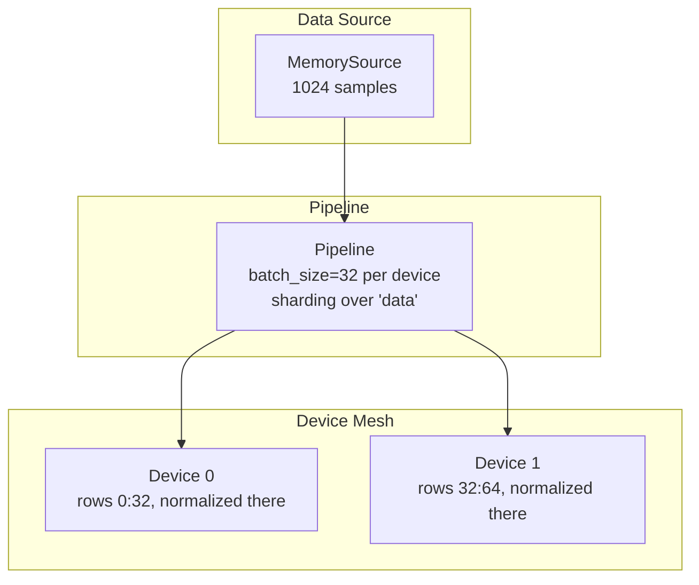

# Sharded Pipeline Quick Reference

| Metadata | Value |
|----------|-------|
| **Level** | Intermediate |
| **Runtime** | ~5 min |
| **Prerequisites** | Basic Datarax pipeline, JAX sharding concepts |
| **Format** | Python + Jupyter |

## Overview

Distribute a Datarax pipeline's batches across JAX devices. Give the pipeline the sharding of a
batch's rows and iteration places every batch on the device mesh, so the pipeline's operators
and your step run on each device's share of the batch.

## What You'll Learn

1. Create a JAX device mesh for data parallelism
2. Build a pipeline that places its batches on the mesh
3. Verify how each batch is distributed across devices
4. Read an evaluation's short final batch, placed whole on every device

## Coming from PyTorch?

| PyTorch | Datarax |
|---------|---------|
| `DistributedSampler(dataset)` | JAX `Mesh` with `PartitionSpec` |
| `DataParallel(model)` | Data sharded along batch dimension |
| `torch.distributed.init_process_group()` | `DeviceMeshManager.create_data_parallel_mesh()` |
| `sampler.set_epoch(epoch)` | Each epoch's order is keyed by the pipeline's `rngs` |

**Key difference:** Datarax uses JAX's built-in GSPMD for transparent sharding without explicit communication.

## Coming from TensorFlow?

| TensorFlow | Datarax |
|------------|---------|
| `tf.distribute.MirroredStrategy` | `Mesh` with data axis |
| `strategy.experimental_distribute_dataset` | `Pipeline(..., sharding=sharding)` |
| `tf.distribute.Strategy.scope()` | `jax.set_mesh(mesh)` |
| `strategy.reduce()` | JAX handles via GSPMD |

## Files

- **Python Script**: [`examples/advanced/distributed/01_sharding_quickref.py`](https://github.com/avitai/datarax/blob/main/examples/advanced/distributed/01_sharding_quickref.py)
- **Jupyter Notebook**: [`examples/advanced/distributed/01_sharding_quickref.ipynb`](https://github.com/avitai/datarax/blob/main/examples/advanced/distributed/01_sharding_quickref.ipynb)

## Quick Start

```bash
python examples/advanced/distributed/01_sharding_quickref.py
```

## Architecture



## Key Concepts

The terminal output below is from a run on two CPU devices
(`XLA_FLAGS=--xla_force_host_platform_device_count=2`). The same code runs on one device, a mesh
of one, and on several GPUs.

### Step 1: Device Mesh Setup

substrax's `DeviceMeshManager` builds a mesh with Auto axes, so XLA infers how a computation over
sharded inputs is partitioned:

```python
# Data parallelism: every device along the "data" axis
mesh = DeviceMeshManager.create_data_parallel_mesh()
sharding = create_data_parallel_sharding(mesh)
num_devices = mesh.devices.size

print(f"Mesh with {num_devices} device(s) along 'data'")
print(f"Batch sharding: {sharding.spec}")
```

**Terminal Output:**
```
Mesh with 2 device(s) along 'data'
Batch sharding: P('data',)
```

### Step 2: Create Data and a Sharded Pipeline

The source and the operators are defined as for one device. The pipeline takes the sharding; its
batch size must split over the `"data"` axis, so it scales with the device count:

```python
# Create sample data
num_samples = 1024
rng = np.random.default_rng(0)
data = {
    "image": rng.random((num_samples, 32, 32, 3), dtype=np.float32),
    "feature": rng.random((num_samples, 128), dtype=np.float32),
    "label": rng.integers(0, 10, (num_samples,), dtype=np.int32),
}
source = MemorySource(MemorySourceConfig(), data=data)


# Define normalization operator
def normalize(element, key=None):
    """Normalize image to [0, 1] range."""
    return element.update_data({"image": element.data["image"] / 255.0})


normalizer = ElementOperator(
    ElementOperatorConfig(stochastic=False), fn=normalize, rngs=nnx.Rngs(0)
)

batch_size = 32 * num_devices  # 32 records per device
pipeline = Pipeline(
    source=source,
    stages=[normalizer],
    batch_size=batch_size,
    rngs=nnx.Rngs(0),
    sharding=sharding,
)

print(f"Data samples: {num_samples}")
print(f"Pipeline created with batch_size={batch_size}")
```

**Terminal Output:**
```
Data samples: 1024
Pipeline created with batch_size=64
```

### Step 3: Process Sharded Batches

Each batch arrives with every array split along the `"data"` axis, and the pipeline's operators
ran on each device's share. The loop runs under `jax.set_mesh(mesh)`, where computations on the
sharded arrays run across the devices:

```python
# Process batches
print("\nProcessing batches:")
with jax.set_mesh(mesh):
    for i, batch in enumerate(pipeline):
        if i >= 2:
            break
        print(f"Batch {i}:")
        print(f"  Image shape: {batch['image'].shape}")
        print(f"  Image sharding: {batch['image'].sharding.spec}")
        print(f"  Rows per device: {batch['image'].addressable_shards[0].data.shape[0]}")
        print(f"  Label shape: {batch['label'].shape}")
```

**Terminal Output:**
```
Processing batches:
Batch 0:
  Image shape: (64, 32, 32, 3)
  Image sharding: P('data',)
  Rows per device: 32
  Label shape: (64,)
Batch 1:
  Image shape: (64, 32, 32, 3)
  Image sharding: P('data',)
  Rows per device: 32
  Label shape: (64,)
```

### Step 4: The Final Batch of an Evaluation

An evaluation over 1,000 records ends on a short batch, whose rows the `"data"` axis cannot split.
The pipeline places it whole on every device (`PartitionSpec()`), so every record is evaluated
once and no batch holds padding. A step over it compiles once more, on the first pass:

```python
evaluation = Pipeline(
    source=MemorySource(MemorySourceConfig(), data={k: v[:1000] for k, v in data.items()}),
    stages=[normalizer],
    batch_size=batch_size,
    rngs=nnx.Rngs(0),
    sharding=sharding,
)
with jax.set_mesh(mesh):
    batches = list(evaluation)
records = sum(batch["label"].shape[0] for batch in batches)
final = batches[-1]
print(f"Batches: {len(batches)}, records evaluated: {records}")
print(f"Final batch: {final['label'].shape[0]} rows, sharding {final['label'].sharding.spec}")
```

**Terminal Output:**
```
Batches: 16, records evaluated: 1000
Final batch: 40 rows, sharding P()
```

## Mesh Configurations

| Pattern | Mesh Shape | Use Case |
|---------|------------|----------|
| Data Parallel | `("data",)` | Replicate model, shard data |
| Model Parallel | `("model",)` | Shard model, replicate data |
| Hybrid | `("data", "model")` | Large models + large batches |

A pipeline's `sharding` places the rows of its batches. On a hybrid mesh it names the data axis,
`NamedSharding(mesh, PartitionSpec("data"))`, and every batch is replicated along `"model"`.

## Results Summary

| Feature | Value |
|---------|-------|
| Device Count | Depends on system |
| Mesh Shape | (N,) for N devices |
| Full batches | Rows split along `"data"` |
| An evaluation's final short batch | Whole on every device |

**Sharding benefits:**

- **Memory efficiency**: each device holds its share of every full batch
- **Throughput**: the pipeline's operators run on every device's share in parallel
- **Scalability**: the same code runs on one device or many

## Next Steps

- [Sharding Guide](sharding-guide.md) - Advanced sharding patterns
- [Checkpointing](../checkpointing/checkpoint-quickref.md) - Save distributed state
- [Performance Guide](../performance/optimization-guide.md) - Optimize throughput
- [API Reference: Sharding](../../../sharding/index.md) - Complete API
