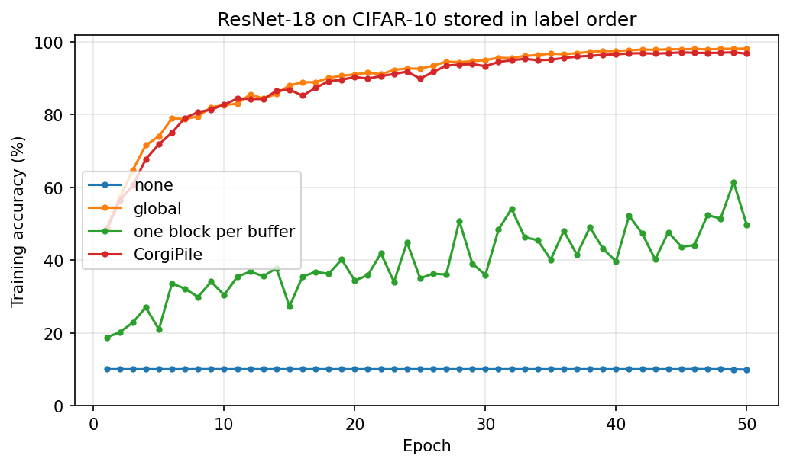

# Training from Data on Disk in a Block Order

| Metadata | Value |
|----------|-------|
| **Level** | Advanced |
| **Runtime** | ~1 min (CPU, quick mode) / ~27 min (A100, full run) |
| **Prerequisites** | Pipeline basics, the operators tutorial |
| **Format** | Python + Jupyter |
| **Memory** | ~4 GB RAM; the full run writes a 61.5 GB copy to disk |

## Overview

A shuffled epoch reads its records in a global random order. From memory that costs nothing.
From a copy on disk larger than the page cache, every record costs a device read of a whole
page run, so the disk moves far more bytes than the batch holds. `BlockOrder` reads each batch
from a few blocks of consecutive records instead.

The obvious worry is training quality: data on disk is often stored in label order, written
class by class, and a partial shuffle over such data can stall training. This example
reproduces the CIFAR-10 experiment of CorgiPile (Xu et al., "Stochastic Gradient Descent
without Full Data Shuffle", arXiv 2206.05830), whose buffer order `BlockOrder` implements, on
data sorted by label. It then measures what each order costs when the copy is read cold.

## Learning Goals

By the end of this example, you will be able to:

1. Store a dataset as on-disk columns and read it with `StreamingDiskSource`
2. Train in a block order with `Pipeline(shuffle=True, block_order=BlockOrder(...))`
3. Choose `block_size` and `blocks_per_buffer` from what each batch must mix
4. Measure a cold read's records per second and the bytes it moves per record

## Files

- **Python Script**: [`examples/advanced/performance/02_block_order_guide.py`](https://github.com/avitai/datarax/blob/main/examples/advanced/performance/02_block_order_guide.py)
- **Jupyter Notebook**: [`examples/advanced/performance/02_block_order_guide.ipynb`](https://github.com/avitai/datarax/blob/main/examples/advanced/performance/02_block_order_guide.ipynb)

## Quick Start

```bash
python scripts/prepare_example_datasets.py
python examples/advanced/performance/02_block_order_guide.py
```

The outputs on this page come from one full run (`QUICK_MODE = False`) on an NVIDIA
A100-SXM4-80GB with 30 vCPUs, 216 GiB of RAM and a virtio root disk, jax 0.11.1, flax 0.12.9 and
XLA's deterministic GPU ops (`XLA_FLAGS=--xla_gpu_deterministic_ops=true`). The run took 27
minutes.

## Setup

```bash
uv pip install "datarax[data]" optax matplotlib
# Prepare CIFAR-10 once as ArrayRecord, in a process of its own: preparing imports
# TensorFlow (the tfds extra); the example reads the prepared copy without it
uv pip install "datarax[tfds]"
python scripts/prepare_example_datasets.py
```

The cold-read part evicts the copy's files from the page cache with `posix_fadvise` and counts
the bytes read from `/proc/self/io`, so its measurements need Linux. Elsewhere it still runs and
reports records per second only.

```python
import gc
import math
import os
import time
from contextlib import closing
from pathlib import Path

import jax
import jax.numpy as jnp
import matplotlib.pyplot as plt
import numpy as np
import optax
from flax import nnx
from substrax.artifacts import resolve_output_dir

from datarax import BlockOrder, HostResources
from datarax.core.host_resources import available_cpus
from datarax.core.index_words import to_words
from datarax.operators import (
    ElementOperator,
    ElementOperatorConfig,
    ProbabilisticOperator,
    ProbabilisticOperatorConfig,
)
from datarax.operators.modality.image import (
    FlipOperator,
    FlipOperatorConfig,
    RandomCropOperator,
    RandomCropOperatorConfig,
)
from datarax.pipeline import Pipeline
from datarax.sources import (
    DiskColumn,
    StreamingDiskSource,
    StreamingDiskSourceConfig,
    TFDSEagerConfig,
    TFDSEagerSource,
)


print(f"JAX backend: {jax.default_backend()}")
print(f"JAX devices: {jax.devices()}")
```

**Terminal Output:**

```text
JAX backend: gpu
JAX devices: [CudaDevice(id=0)]
```

## Configuration

The recipe is CorgiPile's `cifar_dl_bench/cifar_dl_bench_train.py` (DS3Lab/CorgiPile-PyTorch
`b25447c`): ResNet-18 in its CIFAR form, SGD with momentum 0.9 and weight decay 5e-4, learning
rate 0.001 on a cosine schedule stepped once an epoch, batch 128, a 4-pixel padded random crop
and a horizontal flip, and the training set sorted by label. Its CorgiPile order splits the
records into 500 blocks and shuffles a buffer of 10% of them: on CIFAR-10's 50,000 records,
blocks of 100 records, 50 blocks to a buffer. The paper (arXiv 2206.05830v1, section 7.2.2 and
Figure 8(c)) trains 50 epochs with these blocks and buffer. It describes an exponential learning
rate decay of 0.95; the released script declares `lr_decay = 0.95` (line 361) but never uses it
and schedules the cosine, which this example follows.

`QUICK_MODE` trains a narrow network on 2,000 records for two epochs so the example runs in
the test suite's time budget; set it to `False` for the full run.

```python
QUICK_MODE = True

TRAIN_RECORDS = 2_000 if QUICK_MODE else 50_000
EPOCHS = 2 if QUICK_MODE else 50
WIDTH = 16 if QUICK_MODE else 64  # ResNet-18's first stage; the stages double it
BATCH_SIZE = 128
LEARNING_RATE = 1e-3
MOMENTUM = 0.9
WEIGHT_DECAY = 5e-4
EVAL_BATCH_SIZE = 500 if QUICK_MODE else 1_000

# CorgiPile's order: block_num = 500 blocks, a buffer of buffer_size_ratio = 0.1 of the records
BLOCK_SIZE = TRAIN_RECORDS // 500
BLOCKS_PER_BUFFER = int(0.1 * TRAIN_RECORDS) // BLOCK_SIZE

# The cold read: CIFAR-10 tiled into a copy several times larger than the timed reads
READ_TILES = 2 if QUICK_MODE else 400
READ_BATCH_SIZE = 128 if QUICK_MODE else 512
READ_STEPS = 5 if QUICK_MODE else 150
READ_WARMUP = 2 if QUICK_MODE else 20

CIFAR10_MEAN = np.array([0.4914, 0.4822, 0.4465], np.float32)
CIFAR10_STD = np.array([0.2023, 0.1994, 0.2010], np.float32)  # CorgiPile's values

HOST = HostResources(ram_budget_bytes=8 << 30, max_workers=min(8, available_cpus()))
output_dir = resolve_output_dir("examples/block_order").path

print(f"Records: {TRAIN_RECORDS}, epochs: {EPOCHS}, width: {WIDTH}")
print(
    f"CorgiPile order: BlockOrder(block_size={BLOCK_SIZE}, blocks_per_buffer={BLOCKS_PER_BUFFER})"
)
```

**Terminal Output:**

```text
Records: 50000, epochs: 50, width: 64
CorgiPile order: BlockOrder(block_size=100, blocks_per_buffer=50)
```

## Part 1: CIFAR-10 stored in label order

`TFDSEagerSource` reads the prepared split into memory. The records are then written to disk as two `.npy`
columns sorted by label, as a dataset written one class folder at a time would be. A stable
sort keeps each class in its stored order, as CorgiPile's `sorted(key=label)` does. In quick
mode every 25th record is kept, which leaves the subset sorted with every class in it.

`StreamingDiskSource` reads the columns through memory maps. It is an `INDEXED` source, the
kind a block order applies to; a decoded copy written by `materialize` opens as the same
reader.

```python
COLUMNS = ("image", "label")


def write_columns(directory: Path, image: np.ndarray, label: np.ndarray, tiles: int = 1) -> None:
    """Write ``tiles`` copies of the records as ``.npy`` columns.

    Args:
        directory: Where the two column files go.
        image: The images, ``(N, 32, 32, 3)`` uint8.
        label: The labels, ``(N,)``.
        tiles: How many times the records repeat, one copy after another.
    """
    directory.mkdir(parents=True, exist_ok=True)
    rows = len(image) * tiles
    images = np.lib.format.open_memmap(
        directory / "image.npy", "w+", np.uint8, (rows, *image.shape[1:])
    )
    labels = np.lib.format.open_memmap(directory / "label.npy", "w+", np.int32, (rows,))
    for tile in range(tiles):
        images[tile * len(image) : (tile + 1) * len(image)] = image
        labels[tile * len(image) : (tile + 1) * len(image)] = label
    images.flush()
    labels.flush()
    del images, labels


def open_columns(directory: Path) -> StreamingDiskSource:
    """Open the ``.npy`` columns in ``directory`` as a source read through memory maps."""
    columns = tuple(DiskColumn.from_npy(name, directory / f"{name}.npy") for name in COLUMNS)
    return StreamingDiskSource(StreamingDiskSourceConfig(columns=columns))


split = TFDSEagerSource(TFDSEagerConfig(name="cifar10", split="train"))
records = split.get_batch(to_words(np.arange(len(split)))).data
by_label = np.argsort(records["label"], kind="stable")
if QUICK_MODE:
    by_label = by_label[:: len(by_label) // TRAIN_RECORDS]
cifar_images = records["image"][by_label]
cifar_labels = records["label"][by_label].astype(np.int32)
del records

write_columns(output_dir / "cifar10_by_label", cifar_images, cifar_labels)
sorted_source = open_columns(output_dir / "cifar10_by_label")
print(f"Stored records: {len(sorted_source)}")
print(f"First labels: {cifar_labels[:5].tolist()}, last labels: {cifar_labels[-5:].tolist()}")
# Expected output (quick mode):
# Stored records: 2000
# First labels: [0, 0, 0, 0, 0], last labels: [9, 9, 9, 9, 9]
```

**Terminal Output:**

```text
Stored records: 50000
First labels: [0, 0, 0, 0, 0], last labels: [9, 9, 9, 9, 9]
```

## Part 2: Four orders over the sorted records

| order | `Pipeline` arguments | CorgiPile's name |
|---|---|---|
| none | `shuffle=False` | No Shuffle |
| global | `shuffle=True` | Shuffle Once (a new order each epoch here) |
| one block per buffer | `block_order=BlockOrder(block_size=100, blocks_per_buffer=1)` | close to Block-Only |
| CorgiPile | `block_order=BlockOrder(block_size=100, blocks_per_buffer=50)` | CorgiPile |

CorgiPile's Block-Only shuffles the blocks and keeps each block's records in order; a buffer of
one block also shuffles the records inside the block. Either way a batch of 128 sorted records
holds one or two classes.

### The augmentation and the model

The stages are CorgiPile's transforms: `RandomCrop(32, padding=4)`, `RandomHorizontalFlip()`,
then normalization. Each record's crop and flip are drawn from the record's own key, so every
order trains on the same draws for the same record and epoch.

```python
def normalize(element, key=None):  # noqa: ARG001
    """Scale to [0, 1] and normalize with CorgiPile's channel statistics."""
    del key
    image = element.data["image"].astype(jnp.float32) / 255.0
    return element.update_data(
        {"image": (image - CIFAR10_MEAN) / CIFAR10_STD, "label": element.data["label"]}
    )


def train_stages(seed: int = 0) -> list[nnx.Module]:
    """Crop with 4-pixel padding, flip with probability 0.5, then normalize."""
    crop = RandomCropOperator(
        RandomCropOperatorConfig(
            field_key="image", size=(32, 32), padding=4, stochastic=True, stream_name="crop"
        ),
        rngs=nnx.Rngs(crop=seed),
    )
    flip = ProbabilisticOperator(
        ProbabilisticOperatorConfig(probability=0.5, stream_name="flip"),
        operator=FlipOperator(FlipOperatorConfig(field_key="image")),
        rngs=nnx.Rngs(flip=seed + 1),
    )
    prep = ElementOperator(ElementOperatorConfig(stochastic=False), fn=normalize, rngs=nnx.Rngs(0))
    return [crop, flip, prep]


def test_stages() -> list[nnx.Module]:
    """Normalization only."""
    return [
        ElementOperator(ElementOperatorConfig(stochastic=False), fn=normalize, rngs=nnx.Rngs(0))
    ]
```

The model is the ResNet-18 CorgiPile trains (`cifar_dl_bench/models/resnet.py`, kuangliu's
CIFAR ResNet): a 3 x 3 stride-1 stem, four stages of two basic blocks, global average pooling.
Its initialization follows PyTorch's defaults, so the starting point matches the reference:
convolution and linear weights uniform with variance 1 / (3 fan_in), the linear bias uniform in
plus or minus 1 / sqrt(fan_in), batch norm with PyTorch's momentum 0.1 (NNX's `momentum=0.9`)
and epsilon 1e-5.

```python
TORCH_KERNEL_INIT = nnx.initializers.variance_scaling(1 / 3, "fan_in", "uniform")


def torch_bias_init(fan_in: int):
    """PyTorch's ``nn.Linear`` bias initialization: uniform in plus or minus 1 / sqrt(fan_in)."""
    bound = 1 / math.sqrt(fan_in)

    def init(key, shape, dtype=jnp.float32):
        return jax.random.uniform(key, shape, dtype, -bound, bound)

    return init


def conv(cin: int, cout: int, size: int, stride: int, rngs: nnx.Rngs) -> nnx.Conv:
    """A bias-free convolution with PyTorch's initialization and padding."""
    return nnx.Conv(
        cin,
        cout,
        (size, size),
        strides=(stride, stride),
        padding=size // 2,
        use_bias=False,
        kernel_init=TORCH_KERNEL_INIT,
        rngs=rngs,
    )


def batch_norm(features: int, rngs: nnx.Rngs) -> nnx.BatchNorm:
    """Batch norm with PyTorch's running-average momentum and epsilon."""
    return nnx.BatchNorm(features, momentum=0.9, epsilon=1e-5, rngs=rngs)


class BasicBlock(nnx.Module):
    """Two 3 x 3 convolutions with a projection shortcut when the shape changes."""

    def __init__(self, cin: int, cout: int, stride: int, *, rngs: nnx.Rngs) -> None:
        self.conv1 = conv(cin, cout, 3, stride, rngs)
        self.bn1 = batch_norm(cout, rngs)
        self.conv2 = conv(cout, cout, 3, 1, rngs)
        self.bn2 = batch_norm(cout, rngs)
        self.shortcut = (
            nnx.Sequential(conv(cin, cout, 1, stride, rngs), batch_norm(cout, rngs))
            if stride != 1 or cin != cout
            else None
        )

    def __call__(self, x: jax.Array) -> jax.Array:
        out = nnx.relu(self.bn1(self.conv1(x)))
        out = self.bn2(self.conv2(out))
        return nnx.relu(out + (x if self.shortcut is None else self.shortcut(x)))


class ResNet18(nnx.Module):
    """ResNet-18 for 32 x 32 images."""

    def __init__(self, width: int = 64, num_classes: int = 10, *, rngs: nnx.Rngs) -> None:
        self.conv1 = conv(3, width, 3, 1, rngs)
        self.bn1 = batch_norm(width, rngs)
        blocks, cin = [], width
        for stage, stride in enumerate((1, 2, 2, 2)):
            cout = width * 2**stage
            blocks += [
                BasicBlock(cin, cout, stride, rngs=rngs),
                BasicBlock(cout, cout, 1, rngs=rngs),
            ]
            cin = cout
        self.blocks = nnx.List(blocks)
        self.linear = nnx.Linear(
            cin,
            num_classes,
            kernel_init=TORCH_KERNEL_INIT,
            bias_init=torch_bias_init(cin),
            rngs=rngs,
        )

    def __call__(self, x: jax.Array) -> jax.Array:
        out = nnx.relu(self.bn1(self.conv1(x)))
        for block in self.blocks:
            out = block(out)
        return self.linear(jnp.mean(out, axis=(1, 2)))
```

### The optimizer and the steps

PyTorch's `SGD(lr, momentum=0.9, weight_decay=5e-4)` adds the decay to the gradient before the
momentum, which is `optax.add_decayed_weights` before `optax.sgd`. `CosineAnnealingLR(T_max=E)`
stepped once an epoch is a cosine over the epoch index, held for the epoch's steps.

```python
def cosine_by_epoch(steps_per_epoch: int):
    """The learning rate of PyTorch's ``CosineAnnealingLR(T_max=EPOCHS)``, stepped per epoch."""

    def schedule(step):
        epoch = step // steps_per_epoch
        return LEARNING_RATE * 0.5 * (1 + jnp.cos(jnp.pi * epoch / EPOCHS))

    return schedule


def make_optimizer(model: nnx.Module, steps_per_epoch: int) -> nnx.Optimizer:
    """SGD with momentum and coupled weight decay, as PyTorch applies it."""
    tx = optax.chain(
        optax.add_decayed_weights(WEIGHT_DECAY),
        optax.sgd(cosine_by_epoch(steps_per_epoch), momentum=MOMENTUM),
    )
    return nnx.Optimizer(model, tx, wrt=nnx.Param)


@nnx.jit
def train_step(
    model: ResNet18, optimizer: nnx.Optimizer, image: jax.Array, label: jax.Array
) -> jax.Array:
    """One SGD step on a batch; returns the batch's mean cross-entropy."""

    def loss_fn(model: ResNet18) -> jax.Array:
        logits = model(image)
        return optax.softmax_cross_entropy_with_integer_labels(logits, label).mean()

    loss, grads = nnx.value_and_grad(loss_fn)(model)
    optimizer.update(model, grads)
    return loss


@nnx.jit
def correct(model: ResNet18, image: jax.Array, label: jax.Array) -> jax.Array:
    """How many records of the batch the model classifies correctly."""
    return jnp.sum(jnp.argmax(model(image), axis=-1) == label)


@jax.jit
def classes_in(label: jax.Array) -> jax.Array:
    """How many distinct classes a batch holds."""
    return jnp.sum(jnp.bincount(label, length=10) > 0)


def accuracy(model: ResNet18, pipeline: Pipeline) -> float:
    """Percent of one pass over ``pipeline`` classified correctly, the model in eval mode."""
    pipeline.reset()
    hits, total = jnp.zeros((), jnp.int32), 0
    for batch in pipeline:
        hits = hits + correct(model, batch["image"], batch["label"])
        total += batch["label"].shape[0]
    return 100.0 * int(hits) / total
```

### Training

Each order trains a model from the same initial weights for `EPOCHS` epochs. After every epoch
the model is evaluated as CorgiPile reports it, on the training set with the training
augmentation and the model in eval mode, and also on the test set. `drop_last=True` keeps every
batch at 128 records, so the step compiles once; PyTorch's loader instead ends each epoch with a
batch of 80.

```python
ORDERS = {
    "none": {"shuffle": False, "block_order": None},
    "global": {"shuffle": True, "block_order": None},
    "one block per buffer": {
        "shuffle": True,
        "block_order": BlockOrder(block_size=BLOCK_SIZE, blocks_per_buffer=1),
    },
    "CorgiPile": {
        "shuffle": True,
        "block_order": BlockOrder(block_size=BLOCK_SIZE, blocks_per_buffer=BLOCKS_PER_BUFFER),
    },
}

test_split = TFDSEagerSource(
    TFDSEagerConfig(name="cifar10", split="test[:1000]" if QUICK_MODE else "test")
)


def train_in_order(
    name: str, shuffle: bool, block_order: BlockOrder | None
) -> dict[str, list[float]]:
    """Train one model in one order; return its per-epoch accuracies."""
    model = ResNet18(WIDTH, rngs=nnx.Rngs(0))
    steps_per_epoch = len(sorted_source) // BATCH_SIZE
    optimizer = make_optimizer(model, steps_per_epoch)
    history = {"train": [], "test": [], "classes_per_batch": []}
    train = Pipeline(
        source=sorted_source,
        stages=train_stages(),
        batch_size=BATCH_SIZE,
        rngs=nnx.Rngs(0),
        shuffle=shuffle,
        block_order=block_order,
        drop_last=True,
        host_resources=HOST,
    )
    train_eval = Pipeline(
        source=sorted_source,
        stages=train_stages(seed=1),
        batch_size=EVAL_BATCH_SIZE,
        rngs=nnx.Rngs(1),
        host_resources=HOST,
    )
    test = Pipeline(
        source=test_split, stages=test_stages(), batch_size=EVAL_BATCH_SIZE, rngs=nnx.Rngs(2)
    )
    with closing(train), closing(train_eval), closing(test):
        begin = time.perf_counter()
        for epoch in range(EPOCHS):
            if epoch:
                train.reset()
            model.train()
            classes = []
            for batch in train:
                train_step(model, optimizer, batch["image"], batch["label"])
                if epoch == 0:
                    classes.append(classes_in(batch["label"]))
            model.eval()
            history["train"].append(accuracy(model, train_eval))
            history["test"].append(accuracy(model, test))
            if epoch == 0:
                history["classes_per_batch"] = [float(np.mean(jax.device_get(classes)))]
            if epoch == 0 or (epoch + 1) % 10 == 0 or epoch + 1 == EPOCHS:
                print(
                    f"[{name:>20}] epoch {epoch + 1:2d}: train acc {history['train'][-1]:6.2f}  "
                    f"test acc {history['test'][-1]:6.2f}  ({time.perf_counter() - begin:.0f} s)"
                )
    return history


results = {name: train_in_order(name, **order) for name, order in ORDERS.items()}
```

**Terminal Output:**

```text
[                none] epoch  1: train acc  10.00  test acc  10.00  (17 s)
[                none] epoch 10: train acc  10.00  test acc  10.00  (76 s)
[                none] epoch 20: train acc  10.00  test acc  10.00  (141 s)
[                none] epoch 30: train acc  10.00  test acc  10.01  (206 s)
[                none] epoch 40: train acc  10.00  test acc  10.00  (270 s)
[                none] epoch 50: train acc   9.91  test acc   9.98  (335 s)
[              global] epoch  1: train acc  48.86  test acc  49.54  (11 s)
[              global] epoch 10: train acc  82.64  test acc  80.39  (70 s)
[              global] epoch 20: train acc  91.07  test acc  85.94  (137 s)
[              global] epoch 30: train acc  95.02  test acc  88.12  (203 s)
[              global] epoch 40: train acc  97.47  test acc  88.89  (269 s)
[              global] epoch 50: train acc  98.16  test acc  89.23  (336 s)
[one block per buffer] epoch  1: train acc  18.75  test acc  18.35  (12 s)
[one block per buffer] epoch 10: train acc  30.40  test acc  32.54  (73 s)
[one block per buffer] epoch 20: train acc  34.38  test acc  34.50  (141 s)
[one block per buffer] epoch 30: train acc  35.95  test acc  37.71  (209 s)
[one block per buffer] epoch 40: train acc  39.67  test acc  38.80  (277 s)
[one block per buffer] epoch 50: train acc  49.72  test acc  48.96  (344 s)
[           CorgiPile] epoch  1: train acc  48.34  test acc  48.52  (12 s)
[           CorgiPile] epoch 10: train acc  82.76  test acc  80.03  (74 s)
[           CorgiPile] epoch 20: train acc  90.37  test acc  85.71  (145 s)
[           CorgiPile] epoch 30: train acc  93.35  test acc  86.38  (214 s)
[           CorgiPile] epoch 40: train acc  96.62  test acc  88.73  (284 s)
[           CorgiPile] epoch 50: train acc  96.79  test acc  88.71  (354 s)
```

## Results: accuracy by order

The table lists each order's mean number of classes in a batch over the first epoch, the
training accuracy CorgiPile plots, and the test accuracy, after the last epoch.

```python
print(f"{'order':>22} | classes/batch | train acc | test acc")
for name, history in results.items():
    print(
        f"{name:>22} | {history['classes_per_batch'][0]:13.2f} | "
        f"{history['train'][-1]:9.2f} | {history['test'][-1]:8.2f}"
    )

figure, axis = plt.subplots(figsize=(7, 4.2))
epochs = np.arange(1, EPOCHS + 1)
for name, history in results.items():
    axis.plot(epochs, history["train"], marker="o", markersize=3, label=name)
axis.set_xlabel("Epoch")
axis.set_ylabel("Training accuracy (%)")
axis.set_title("ResNet-18 on CIFAR-10 stored in label order")
axis.set_ylim(0, 102)
axis.grid(alpha=0.3)
axis.legend()
figure.tight_layout()
figure.savefig(
    output_dir / "perf-block-order-accuracy.png", dpi=150, bbox_inches="tight", facecolor="white"
)
plt.close(figure)
print(f"Saved {output_dir / 'perf-block-order-accuracy.png'}")
```

**Terminal Output:**

```text
                 order | classes/batch | train acc | test acc
                  none |          1.02 |      9.91 |     9.98
                global |         10.00 |     98.16 |    89.23
  one block per buffer |          2.11 |     49.72 |    48.96
             CorgiPile |          9.98 |     96.79 |    88.71
```



### Compared with CorgiPile's figure

The reference values are read off arXiv 2206.05830v1, Figure 8(c) (ResNet-18, batch 128, CIFAR-10
sorted by label, training accuracy at epoch 50); the paper prints no table for it.

| order | CorgiPile-PyTorch (paper) | datarax (this run) |
|---|---|---|
| Shuffle Once / global | about 100% | 98.16% |
| CorgiPile | about 100% | 96.79% |
| Block-Only / one block per buffer | about 55% | 49.72% |
| No Shuffle / none | 10% | 9.91% |

Each order lands where the paper's does. The paper's Shuffle Once shuffles the data once, offline;
the global order here draws a new order each epoch. The training accuracy is measured as the
reference script measures it, with the training augmentation applied, so it stays below the
accuracy on unaugmented training records. The run trained one seed per order, so it does not
measure how much the 1.4-point gap between the global and CorgiPile orders varies between seeds.

## Part 3: What each order costs, read cold

The training copy fits in memory, so after its first epoch every order reads it from the page
cache. To measure reads from the disk, the records are tiled into a larger copy, its pages are
evicted before each measurement, and each timed window reads a small part of it, so nearly every
page it touches comes from the disk. The kernel keeps a page that a memory map still holds, so
each measurement evicts the files first and only then opens the source it reads through.

Each window reads far less than the host's memory holds, so this part measures reads from the
disk, not data larger than memory.

Two measurements per order:

1. **Supply**: `raw_batches()` alone, records a second and the bytes the process read per
   record over the record's own bytes (the read amplification).
2. **Training**: the same model, timed at a larger batch that keeps a GPU busy, images a second.

Both read on the host stage's threads (`host_resources`). In quick mode the tiled copy is 12 MB,
which the warm-up batches read whole, so its timed windows read nothing from the disk and its
blocks of 4 records are shorter than one kernel read; the full run measures what this part is for.

```python
TILED_DIR = output_dir / "cifar10_tiled"


def evict(directory: Path) -> bool:
    """Drop the column files' pages from the page cache; ``False`` where the platform cannot.

    A page a memory map still holds is not dropped, so call this before the source is opened.
    """
    if not hasattr(os, "posix_fadvise"):
        return False
    gc.collect()  # unmaps the columns of sources no longer referenced
    os.sync()  # written pages must reach the disk before the cache can drop them
    for name in COLUMNS:
        with open(directory / f"{name}.npy", "rb") as handle:
            os.posix_fadvise(handle.fileno(), 0, 0, os.POSIX_FADV_DONTNEED)
    return True


def bytes_read() -> int | None:
    """Bytes this process has read from storage (Linux ``/proc/self/io``), else ``None``."""
    try:
        lines = Path("/proc/self/io").read_text().splitlines()
    except OSError:
        return None
    return next(int(line.split()[1]) for line in lines if line.startswith("read_bytes:"))


ROW_BYTES = 32 * 32 * 3 + 4  # an image and an int32 label
write_columns(TILED_DIR, cifar_images, cifar_labels, tiles=READ_TILES)
TILED_RECORDS = len(cifar_images) * READ_TILES
print(f"Tiled copy: {TILED_RECORDS:,} records, {TILED_RECORDS * ROW_BYTES / 1e9:.1f} GB")


def cold_pipeline(block_order: BlockOrder | None) -> tuple[Pipeline, bool]:
    """The tiled copy, evicted, then opened and shuffled in ``block_order``, without end.

    Returns:
        The pipeline, and whether the copy was evicted first.
    """
    is_cold = evict(TILED_DIR)
    pipeline = Pipeline(
        source=open_columns(TILED_DIR),
        stages=train_stages(),
        batch_size=READ_BATCH_SIZE,
        rngs=nnx.Rngs(0),
        shuffle=True,
        block_order=block_order,
        num_epochs=None,
        host_resources=HOST,
    )
    return pipeline, is_cold


def measure_supply(block_order: BlockOrder | None) -> dict[str, float | None]:
    """Records a second ``raw_batches()`` serves from the cold copy, and bytes read per record."""
    pipeline, is_cold = cold_pipeline(block_order)
    with closing(pipeline):
        batches = iter(pipeline.raw_batches())
        for _ in range(READ_WARMUP):
            jax.block_until_ready(next(batches).data)
        before, begin = bytes_read(), time.perf_counter()
        for _ in range(READ_STEPS):
            jax.block_until_ready(next(batches).data)
        seconds, after = time.perf_counter() - begin, bytes_read()
    served = READ_STEPS * READ_BATCH_SIZE
    amplification = None
    if is_cold and before is not None and after is not None:
        amplification = (after - before) / (served * ROW_BYTES)
    return {"records_per_s": served / seconds, "amplification": amplification}


def measure_training(block_order: BlockOrder | None) -> float:
    """Images a second the training step processes reading the cold copy."""
    model = ResNet18(WIDTH, rngs=nnx.Rngs(0))
    optimizer = make_optimizer(model, steps_per_epoch=TILED_RECORDS // READ_BATCH_SIZE)
    pipeline, _ = cold_pipeline(block_order)
    with closing(pipeline):
        batches = iter(pipeline)

        def run(steps: int) -> None:
            previous = None
            for _ in range(steps):
                batch = next(batches)
                loss = train_step(model, optimizer, batch["image"], batch["label"])
                if previous is not None:
                    jax.block_until_ready(previous)  # keep one step in flight
                previous = loss
            jax.block_until_ready(previous)

        run(READ_WARMUP)
        begin = time.perf_counter()
        run(READ_STEPS)
        return READ_STEPS * READ_BATCH_SIZE / (time.perf_counter() - begin)


read_orders = {"global": None, "CorgiPile": ORDERS["CorgiPile"]["block_order"]}
reads = {}
for name, block_order in read_orders.items():
    supply = measure_supply(block_order)
    reads[name] = {**supply, "images_per_s": measure_training(block_order)}

print(f"{'order':>10} | supply rec/s | bytes read / record bytes | training img/s")
for name, row in reads.items():
    amplification = "n/a" if row["amplification"] is None else f"{row['amplification']:.2f}"
    supply, images = row["records_per_s"], row["images_per_s"]
    print(f"{name:>10} | {supply:12,.0f} | {amplification:>25} | {images:14,.0f}")

for name in COLUMNS:
    (TILED_DIR / f"{name}.npy").unlink()  # the tiled copy is large; remove the files written
```

**Terminal Output:**

```text
Tiled copy: 20,000,000 records, 61.5 GB
     order | supply rec/s | bytes read / record bytes | training img/s
    global |       13,862 |                     37.37 |         14,127
 CorgiPile |      205,564 |                      1.87 |         14,100
```

Read cold, the global order moved 37 times the bytes it served and supplied 13,862 records a
second alone. The CorgiPile order moved 1.87 times the bytes it served and supplied 15 times as
many records. In the training measurement both orders ran at about 14,100 images a second.

## Interpretation

On data stored in label order, the order decides whether training works at all. With no
shuffle every batch holds one class and the network never gets past chance. A buffer of one
block holds one or two classes a batch and climbs unevenly to about half the records right.
CorgiPile's 50 blocks per buffer put every class in nearly every batch and train like the global
order. That is the paper's result (arXiv 2206.05830v1, Figure 8(c): Shuffle Once and CorgiPile
reach about 100% training accuracy by epoch 50, Block-Only about 55%, No Shuffle 10%).

Read cold, the global order faults a kernel read around every record it names, so the disk moves
dozens of times the bytes the batch holds. The block order reads runs of consecutive records and
moves about the bytes it uses, and its supply alone is many times the global order's. A step
starves when it takes records faster than the order supplies them, so the global order leaves less
headroom for a faster model or a slower disk.

Choosing the parameters: `block_size` sets the length of each contiguous read, and
`blocks_per_buffer` sets how many places in the data one batch draws from. On sorted data a
buffer needs enough blocks that every class appears in it; a buffer's records (block_size x
blocks_per_buffer rows) stay resident while it is served.

## Next Steps

- Try `blocks_per_buffer` of 5 and 10 and watch the classes per batch and the accuracy curve
- Build a decoded copy of an ArrayRecord split with `datarax.pipeline.materialize` and train
  from it in a block order
- Read [data larger than the page cache](../../../user_guide/data_sources.md#data-larger-than-the-page-cache) for the order's
  guarantees: each record once per epoch, exact resume, per-record augmentation keys

### API Reference

- [BlockOrder](../../../core/block_order.md)
- [StreamingDiskSource](../../../sources/streaming_disk_source.md)
- [Decoded copy](../../../sources/decoded_copy.md)

### Further Reading

- Xu et al., "Stochastic Gradient Descent without Full Data Shuffle", arXiv 2206.05830
- CorgiPile's PyTorch code: https://github.com/DS3Lab/CorgiPile-PyTorch
