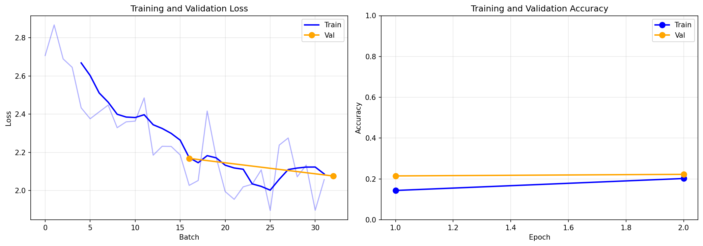
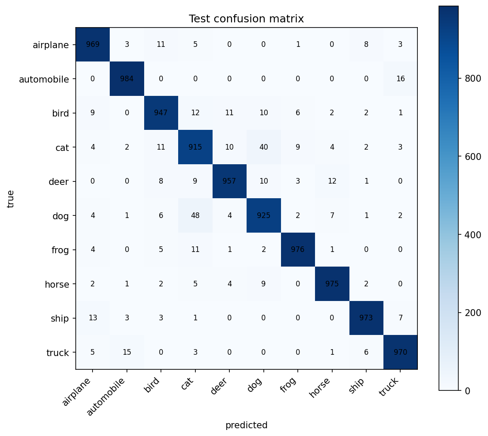
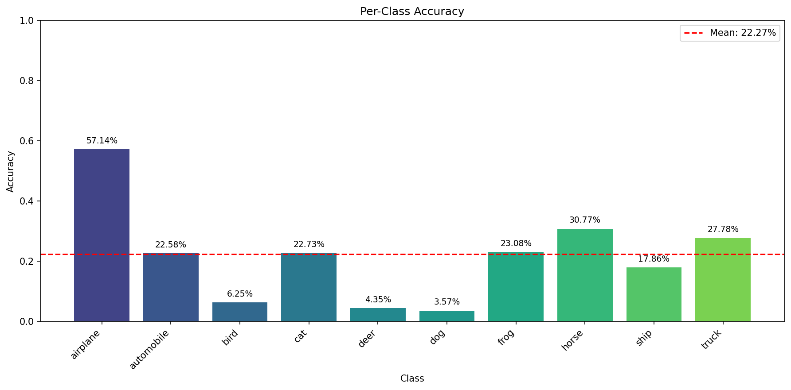
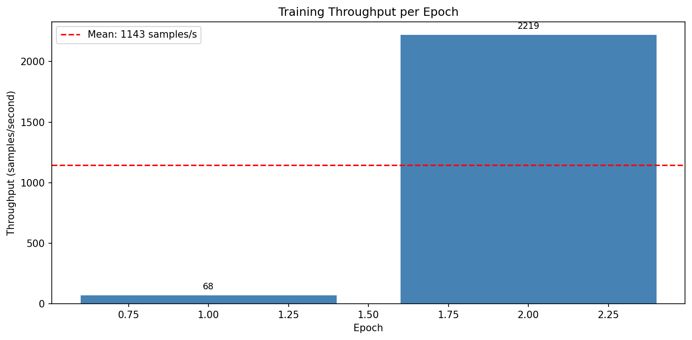

# End-to-End CIFAR-10: Reproducing MixUp with Datarax

| Metadata | Value |
|----------|-------|
| **Level** | Advanced |
| **Runtime** | QUICK_MODE ~15 s (CPU); full run (200 epochs) ~20 min on one A100 |
| **Prerequisites** | MixUp/CutMix tutorial, Operators tutorial |
| **Format** | Python + Jupyter |
| **Memory** | ~2 GB RAM (QUICK_MODE) |

## Overview

This guide trains PreAct ResNet-18 on CIFAR-10 with MixUp, following the code that produced the
MixUp paper's result: [facebookresearch/mixup-cifar10](https://github.com/facebookresearch/mixup-cifar10)
at `eaff31ab` (Zhang, Cisse, Dauphin and Lopez-Paz, "mixup: Beyond Empirical Risk Minimization",
ICLR 2018). The paper reports a CIFAR-10 test error of 4.2% for this setting (Figure 3a), and
4.24% as the median of the last 10 epochs (Table 5). The data path is Datarax's: the CIFAR-10
source, the pad-and-crop, flip and normalization operators, and `BatchMixOperator`, which draws
one mixing ratio and one partner permutation per batch exactly as the reference's `mixup_data`
does. The model and the training step are Flax NNX and optax. The reference is licensed
CC-BY-NC 4.0, so nothing here is copied from it: the recipe is re-implemented from its
description.

## Learning Goals

By the end of this guide, you will be able to:

1. Build a training pipeline from Datarax operators: pad-and-crop, flip, normalization, MixUp
2. Train with the MixUp loss from the partner and ratio the operator records, labels unmixed
3. Port a published PyTorch recipe to Flax NNX faithfully: architecture, initialization,
   optimizer, schedule and evaluation protocol
4. Evaluate in eval mode over every test record and report the paper's statistic

## Files

- **Python Script**: [`examples/advanced/training/01_e2e_cifar10_guide.py`](https://github.com/avitai/datarax/blob/main/examples/advanced/training/01_e2e_cifar10_guide.py)
- **Jupyter Notebook**: [`examples/advanced/training/01_e2e_cifar10_guide.ipynb`](https://github.com/avitai/datarax/blob/main/examples/advanced/training/01_e2e_cifar10_guide.ipynb)

## Quick Start

```bash
# Prepare the example datasets once as ArrayRecord (in its own process: it imports
# TensorFlow; the example reads them without it)
python scripts/prepare_example_datasets.py

python examples/advanced/training/01_e2e_cifar10_guide.py
```

The code below is the script as committed, with `QUICK_MODE = True`. The outputs and figures
come from one full run with `QUICK_MODE = False`, the only line changed, on one NVIDIA
A100-SXM4-80GB with jax 0.11.1 and flax 0.12.9. The 200 epochs took about 18 minutes. A
second full run that also set `USE_MIXUP = False` gives the ERM rows of the results table.

## Setup

```bash
uv pip install "datarax[data]" flax optax matplotlib
# Prepare CIFAR-10 once as ArrayRecord, in a process of its own: preparing imports
# TensorFlow (the tfds extra); the example reads the prepared copy without it
uv pip install "datarax[tfds]"
python -c "import tensorflow_datasets as tfds; tfds.builder('cifar10', file_format='array_record').download_and_prepare()"
```

```python
import math
import statistics
import time
from contextlib import closing

import jax
import jax.numpy as jnp
import matplotlib.pyplot as plt
import numpy as np
import optax
from flax import nnx
from substrax.artifacts import resolve_output_dir
from substrax.testing.compiles import compiled_programs

from datarax.core.config import BatchMixOperatorConfig
from datarax.core.element_batch import Batch
from datarax.core.state_keys import MIX_LAMBDA, MIX_PARTNER
from datarax.operators import (
    ElementOperator,
    ElementOperatorConfig,
    ProbabilisticOperator,
    ProbabilisticOperatorConfig,
)
from datarax.operators.batch_mix_operator import BatchMixOperator
from datarax.operators.modality.image import (
    FlipOperator,
    FlipOperatorConfig,
    RandomCropOperator,
    RandomCropOperatorConfig,
)
from datarax.pipeline import Pipeline
from datarax.sources import TFDSEagerConfig, TFDSEagerSource


print(f"JAX backend: {jax.default_backend()}")
```

**Terminal Output:**

```text
JAX backend: gpu
```

## Configuration

The reference's settings (`train.py` of the reference): batch 128, 200 epochs, SGD with
learning rate 0.1, momentum 0.9 and weight decay 1e-4, MixUp with alpha 1, so the mixing ratio
is uniform on [0, 1]. `QUICK_MODE` trains a narrow network on a slice of the data for two
epochs, so the example runs in the test suite's time budget; it claims no accuracy. Set it to
`False` for the run this page reports. `USE_MIXUP = False` trains the same recipe without MixUp,
the paper's ERM baseline.

```python
QUICK_MODE = True
USE_MIXUP = True

EPOCHS = 2 if QUICK_MODE else 200
TRAIN_SPLIT = "train[:1024]" if QUICK_MODE else "train"
TEST_SPLIT = "test[:500]" if QUICK_MODE else "test"
WIDTH = 16 if QUICK_MODE else 64  # the first stage's channels; the stages double them
BATCH_SIZE = 128
TEST_BATCH_SIZE = 100
LEARNING_RATE = 0.1
MOMENTUM = 0.9
WEIGHT_DECAY = 1e-4
MIXUP_ALPHA = 1.0
# The reference lowers the rate after an epoch's training and test when that epoch's index is
# 100 or 150, so the next epoch trains at the new rate: epochs 0-100 at 0.1, 101-150 at 0.01,
# 151-199 at 0.001.
DECAY_AFTER_EPOCHS = (1,) if QUICK_MODE else (100, 150)

# The reference normalizes with these channel statistics (`transforms.Normalize` in its train.py).
CIFAR10_MEAN = jnp.array([0.4914, 0.4822, 0.4465])
CIFAR10_STD = jnp.array([0.2023, 0.1994, 0.2010])
CLASSES = [
    "airplane", "automobile", "bird", "cat", "deer", "dog", "frog", "horse", "ship", "truck",
]  # fmt: skip

print(f"QUICK_MODE={QUICK_MODE}  MixUp={USE_MIXUP} (alpha={MIXUP_ALPHA})  epochs={EPOCHS}")
```

**Terminal Output:**

```text
QUICK_MODE=False  MixUp=True (alpha=1.0)  epochs=200
```

## The data pipeline

The reference augments each training image with `RandomCrop(32, padding=4)` (zero padding) and
`RandomHorizontalFlip()`, then normalizes; test images are only normalized. Datarax's
`RandomCropOperator` and a `FlipOperator` under a `ProbabilisticOperator` are those transforms;
each record's crop offset and flip are drawn from the record's own key. `BatchMixOperator`
comes last, as the reference mixes the normalized batch: it draws one ratio lambda per batch
from Beta(alpha, alpha), pairs each record with a partner from a random permutation, and records
both for the loss (`batch_state[MIX_LAMBDA]`, `states[MIX_PARTNER]`). The labels stay integers.

One pipeline serves all epochs: `reset()` starts the next epoch, whose order the pipeline
shuffles anew. The reference's loader keeps the last batch of an epoch short (50,000 = 390 x 128
+ 80), and so does this one, so the train step compiles once more for that batch.

```python
def normalize(element, key=None):  # noqa: ARG001
    """Scale to [0, 1] and normalize with the reference's channel statistics."""
    del key
    image = element.data["image"].astype(jnp.float32) / 255.0
    return element.update_data({"image": (image - CIFAR10_MEAN) / CIFAR10_STD})


def train_stages() -> list[nnx.Module]:
    """Pad-4 crop, flip with probability 0.5, normalization, then MixUp if enabled."""
    stages: list[nnx.Module] = [
        RandomCropOperator(
            RandomCropOperatorConfig(
                field_key="image", size=(32, 32), padding=4, stochastic=True, stream_name="crop"
            ),
            rngs=nnx.Rngs(crop=1),
        ),
        ProbabilisticOperator(
            ProbabilisticOperatorConfig(probability=0.5, stream_name="flip"),
            operator=FlipOperator(FlipOperatorConfig(field_key="image")),
            rngs=nnx.Rngs(flip=2),
        ),
        ElementOperator(ElementOperatorConfig(stochastic=False), fn=normalize, rngs=nnx.Rngs(0)),
    ]
    if USE_MIXUP:
        stages.append(
            BatchMixOperator(
                BatchMixOperatorConfig(mode="mixup", alpha=MIXUP_ALPHA, data_field="image"),
                rngs=nnx.Rngs(batch_mix=3),
            )
        )
    return stages


train_source = TFDSEagerSource(TFDSEagerConfig(name="cifar10", split=TRAIN_SPLIT))
test_source = TFDSEagerSource(TFDSEagerConfig(name="cifar10", split=TEST_SPLIT))
train_pipeline = Pipeline(
    source=train_source,
    stages=train_stages(),
    batch_size=BATCH_SIZE,
    rngs=nnx.Rngs(0),
    shuffle=True,
)
test_pipeline = Pipeline(
    source=test_source,
    stages=[
        ElementOperator(ElementOperatorConfig(stochastic=False), fn=normalize, rngs=nnx.Rngs(0))
    ],
    batch_size=TEST_BATCH_SIZE,
    rngs=nnx.Rngs(0),
)
TRAIN_RECORDS, TEST_RECORDS = len(train_source), len(test_source)
STEPS_PER_EPOCH = math.ceil(TRAIN_RECORDS / BATCH_SIZE)
print(f"train records: {TRAIN_RECORDS}  test records: {TEST_RECORDS}")
LAST_BATCH = TRAIN_RECORDS - (STEPS_PER_EPOCH - 1) * BATCH_SIZE
print(f"steps per epoch: {STEPS_PER_EPOCH}, the last one of {LAST_BATCH} records")
```

**Terminal Output:**

```text
train records: 50000  test records: 10000
steps per epoch: 391, the last one of 80 records
```

## The model: PreAct ResNet-18

The reference's `ResNet18()` is `ResNet(PreActBlock, [2, 2, 2, 2])` from its `models/resnet.py`:
a 3 x 3 stem convolution followed by batch norm and ReLU, four stages of two pre-activation
blocks (64, 128, 256, 512 channels; strides 1, 2, 2, 2), 4 x 4 average pooling and a linear head.
A pre-activation block applies batch norm and ReLU before each convolution, and its shortcut
reads that pre-activated input: the block adds `relu(bn(x))` itself when the shape is unchanged
(the reference's empty `nn.Sequential` shortcut applied to it) and a 1 x 1 projection of it when
the shape changes. This is the reference's code, not the identity mapping that adds `x`; with the
reference's weights copied in, this model's output matches the reference's to float32 rounding
(about 1e-6 relative, train and eval mode). All convolutions are
bias-free with padding 1 on both sides. Initialization follows PyTorch's defaults, which the
reference uses: convolution and linear weights uniform with variance 1 / (3 fan_in), the linear
bias uniform in plus or minus 1 / sqrt(fan_in), batch norm with PyTorch's momentum 0.1 (NNX's
`momentum=0.9`) and epsilon 1e-5.

```python
TORCH_KERNEL_INIT = nnx.initializers.variance_scaling(1 / 3, "fan_in", "uniform")


def torch_bias_init(fan_in: int):
    """PyTorch's ``nn.Linear`` bias initialization: uniform in plus or minus 1 / sqrt(fan_in)."""
    bound = 1 / math.sqrt(fan_in)

    def init(key, shape, dtype=jnp.float32):
        return jax.random.uniform(key, shape, dtype, -bound, bound)

    return init


def conv(cin: int, cout: int, size: int, stride: int, rngs: nnx.Rngs) -> nnx.Conv:
    """A bias-free convolution with PyTorch's initialization and symmetric padding."""
    return nnx.Conv(
        cin,
        cout,
        (size, size),
        strides=(stride, stride),
        padding=size // 2,
        use_bias=False,
        kernel_init=TORCH_KERNEL_INIT,
        rngs=rngs,
    )


def batch_norm(features: int, rngs: nnx.Rngs) -> nnx.BatchNorm:
    """Batch norm with PyTorch's running-average momentum and epsilon."""
    return nnx.BatchNorm(features, momentum=0.9, epsilon=1e-5, rngs=rngs)


class PreActBlock(nnx.Module):
    """Batch norm and ReLU before each of two 3 x 3 convolutions; a projection when needed."""

    def __init__(self, cin: int, cout: int, stride: int, *, rngs: nnx.Rngs) -> None:
        self.bn1 = batch_norm(cin, rngs)
        self.conv1 = conv(cin, cout, 3, stride, rngs)
        self.bn2 = batch_norm(cout, rngs)
        self.conv2 = conv(cout, cout, 3, 1, rngs)
        self.shortcut = conv(cin, cout, 1, stride, rngs) if stride != 1 or cin != cout else None

    def __call__(self, x: jax.Array) -> jax.Array:
        out = nnx.relu(self.bn1(x))
        shortcut = out if self.shortcut is None else self.shortcut(out)
        out = self.conv1(out)
        out = self.conv2(nnx.relu(self.bn2(out)))
        return out + shortcut


class PreActResNet18(nnx.Module):
    """PreAct ResNet-18 for 32 x 32 images, as the reference builds it."""

    def __init__(self, width: int = 64, num_classes: int = 10, *, rngs: nnx.Rngs) -> None:
        self.conv1 = conv(3, width, 3, 1, rngs)
        self.bn1 = batch_norm(width, rngs)
        blocks, cin = [], width
        for stage, stride in enumerate((1, 2, 2, 2)):
            cout = width * 2**stage
            blocks += [
                PreActBlock(cin, cout, stride, rngs=rngs),
                PreActBlock(cout, cout, 1, rngs=rngs),
            ]
            cin = cout
        self.blocks = nnx.List(blocks)
        self.linear = nnx.Linear(
            cin,
            num_classes,
            kernel_init=TORCH_KERNEL_INIT,
            bias_init=torch_bias_init(cin),
            rngs=rngs,
        )

    def __call__(self, x: jax.Array) -> jax.Array:
        out = nnx.relu(self.bn1(self.conv1(x)))
        for block in self.blocks:
            out = block(out)
        return self.linear(jnp.mean(out, axis=(1, 2)))  # 4 x 4 average pooling, then the head


def parameter_count(model: nnx.Module) -> int:
    """Trainable parameters (``nnx.Param``), batch-norm scales and offsets included."""
    return sum(leaf.size for leaf in jax.tree.leaves(nnx.state(model, nnx.Param)))


# The reference's ResNet18() has 11,171,274 trainable parameters (counted by instantiating its
# models/resnet.py in PyTorch); the full-width port has exactly as many.
REFERENCE_PARAMETERS = 11_171_274
assert parameter_count(PreActResNet18(64, rngs=nnx.Rngs(0))) == REFERENCE_PARAMETERS

model = PreActResNet18(WIDTH, rngs=nnx.Rngs(0))
print(f"PreAct ResNet-18 at width {WIDTH}: {parameter_count(model):,} parameters")
```

**Terminal Output:**

```text
PreAct ResNet-18 at width 64: 11,171,274 parameters
```

## The optimizer and the steps

PyTorch's `SGD(lr, momentum=0.9, weight_decay=1e-4)` adds the decay to the gradient of every
parameter, batch-norm scales and offsets included, before the momentum: that is
`optax.add_decayed_weights` before `optax.sgd`. The learning rate falls tenfold after epochs 100
and 150 as the reference steps it; optax counts steps, so the boundaries are those epochs' ends.

The MixUp loss is the reference's `mixup_criterion`: lambda times the cross-entropy against each
record's label plus (1 - lambda) times the cross-entropy against its partner's. Training accuracy
weighs the two the same way. Both are summed on the device and read once an epoch.

```python
def learning_rate_schedule() -> optax.Schedule:
    """0.1, divided by 10 after each epoch in ``DECAY_AFTER_EPOCHS``."""
    boundaries = {(epoch + 1) * STEPS_PER_EPOCH: 0.1 for epoch in DECAY_AFTER_EPOCHS}
    return optax.piecewise_constant_schedule(LEARNING_RATE, boundaries)


optimizer = nnx.Optimizer(
    model,
    optax.chain(
        optax.add_decayed_weights(WEIGHT_DECAY),
        optax.sgd(learning_rate_schedule(), momentum=MOMENTUM),
    ),
    wrt=nnx.Param,
)


def mixed_targets(batch: Batch) -> tuple[jax.Array, jax.Array, jax.Array]:
    """Each record's label, its partner's label and the ratio; without MixUp the ratio is 1."""
    labels = batch["label"]
    if MIX_LAMBDA not in batch.batch_state:
        return labels, labels, jnp.ones(())
    return labels, labels[batch.states[MIX_PARTNER]], batch.batch_state[MIX_LAMBDA]


@nnx.jit
def train_step(
    model: PreActResNet18, optimizer: nnx.Optimizer, batch: Batch
) -> tuple[jax.Array, jax.Array]:
    """One SGD step; returns the batch's summed loss and its lambda-weighted correct count."""
    labels, partner_labels, lam = mixed_targets(batch)

    def loss_fn(model: PreActResNet18) -> tuple[jax.Array, jax.Array]:
        logits = model(batch["image"])
        own = optax.softmax_cross_entropy_with_integer_labels(logits, labels)
        partner = optax.softmax_cross_entropy_with_integer_labels(logits, partner_labels)
        return (lam * own + (1 - lam) * partner).mean(), logits

    (loss, logits), grads = nnx.value_and_grad(loss_fn, has_aux=True)(model)
    optimizer.update(model, grads)
    predicted = jnp.argmax(logits, axis=-1)
    correct = lam * (predicted == labels) + (1 - lam) * (predicted == partner_labels)
    return loss * labels.shape[0], correct.sum()


@nnx.jit
def eval_step(
    model: PreActResNet18, image: jax.Array, label: jax.Array
) -> tuple[jax.Array, jax.Array, jax.Array]:
    """The batch's summed cross-entropy, its correct count and its predictions."""
    logits = model(image)
    loss = optax.softmax_cross_entropy_with_integer_labels(logits, label).sum()
    predicted = jnp.argmax(logits, axis=-1)
    return loss, jnp.sum(predicted == label), predicted


def evaluate(model: PreActResNet18) -> tuple[float, float, np.ndarray, np.ndarray]:
    """Test loss and accuracy over every test record, the model in eval mode.

    Batch norm normalizes with its running statistics and leaves them unchanged, as the
    reference's ``net.eval()`` does; the accuracy counts records, not batch means.
    """
    model.eval()
    test_pipeline.reset()
    loss, hits, records = jnp.zeros(()), jnp.zeros((), jnp.int32), 0
    predictions, labels = [], []
    for batch in test_pipeline:
        batch_loss, batch_hits, predicted = eval_step(model, batch["image"], batch["label"])
        loss, hits = loss + batch_loss, hits + batch_hits
        records += batch["label"].shape[0]
        predictions.append(predicted)
        labels.append(batch["label"])
    assert records == TEST_RECORDS, "every test record is evaluated once"
    return (
        float(loss) / records,
        100.0 * int(hits) / records,
        np.concatenate(jax.device_get(predictions)),
        np.concatenate(jax.device_get(labels)),
    )
```

## Training

Each epoch trains on one shuffled pass over the training set in train mode, then evaluates the
whole test set in eval mode, as the reference does every epoch. The script checks after every
epoch that each training record was served once and that evaluation left batch norm's running
statistics unchanged. The log prints the first epoch, every 20th and the last 10.

The loop keeps one step in flight: after dispatching a step it waits for the step before, so the
device runs one step while the pipeline serves the next batch. The time the loop spends waiting
for the pipeline is the data wait. Each epoch line prints its median per step beside the median
step time; while the wait stays well below the step, the data path keeps the device busy. The
script also counts what jax compiles during training: each step function once per batch shape,
which for the full run is the 128-record batch and the 80-record last one, and one test shape.

```python
history = {
    "train_loss": [], "train_acc": [], "test_loss": [], "test_acc": [], "samples_s": [],
    "data_wait_ms": [], "step_ms": [],
}  # fmt: skip
predictions = test_labels = np.zeros(0, np.int64)
with closing(train_pipeline), closing(test_pipeline), compiled_programs() as compiled:
    for epoch in range(EPOCHS):
        if epoch:
            train_pipeline.reset()
        model.train()
        loss_sum, correct_sum, records = jnp.zeros(()), jnp.zeros(()), 0
        waits, steps, in_flight = [], [], None
        begin = mark = time.perf_counter()
        for batch in train_pipeline:
            served = time.perf_counter()
            batch_loss, batch_correct = train_step(model, optimizer, batch)
            if in_flight is not None:
                jax.block_until_ready(in_flight)
            in_flight = batch_loss
            loss_sum, correct_sum = loss_sum + batch_loss, correct_sum + batch_correct
            records += batch["label"].shape[0]
            now = time.perf_counter()
            waits.append(served - mark)
            steps.append(now - mark)
            mark = now
        train_loss, train_acc = float(loss_sum) / records, 100.0 * float(correct_sum) / records
        seconds = time.perf_counter() - begin
        assert records == TRAIN_RECORDS, "every training record is served once an epoch"
        trained = jax.device_get(nnx.state(model, nnx.BatchStat))
        test_loss, test_acc, predictions, test_labels = evaluate(model)
        unchanged = jax.tree.map(
            np.array_equal, trained, jax.device_get(nnx.state(model, nnx.BatchStat))
        )
        assert all(jax.tree.leaves(unchanged)), "evaluation leaves batch norm's statistics alone"
        data_wait_ms = 1e3 * statistics.median(waits)
        step_ms = 1e3 * statistics.median(steps)
        values = (
            train_loss, train_acc, test_loss, test_acc, records / seconds, data_wait_ms, step_ms
        )  # fmt: skip
        for key, value in zip(history, values, strict=True):
            history[key].append(value)
        if epoch == 0 or (epoch + 1) % 20 == 0 or epoch >= EPOCHS - 10:
            print(
                f"epoch {epoch + 1:3d}: train loss {train_loss:.4f}  train acc {train_acc:6.2f}%  "
                f"test loss {test_loss:.4f}  test acc {test_acc:6.2f}%  "
                f"({records / seconds:,.0f} samples/s; data wait {data_wait_ms:.2f} ms "
                f"of a {step_ms:.2f} ms step)"
            )

# Each step function compiles once per batch shape it sees, and never again.
train_shapes = len({BATCH_SIZE, LAST_BATCH})
test_shapes = len({TEST_BATCH_SIZE, TEST_RECORDS % TEST_BATCH_SIZE or TEST_BATCH_SIZE})
compiles = {name: compiled.count(f"jit({name})") for name in ("train_step", "eval_step")}
assert compiles == {"train_step": train_shapes, "eval_step": test_shapes}, compiles
print(
    f"compiled during training: train_step {compiles['train_step']}x, "
    f"eval_step {compiles['eval_step']}x (once per batch shape)"
)
```

**Terminal Output:**

```text
epoch   1: train loss 2.0570  train acc  25.37%  test loss 1.8455  test acc  37.64%  (1,520 samples/s; data wait 1.00 ms of a 10.92 ms step)
epoch  20: train loss 1.1031  train acc  67.63%  test loss 0.5059  test acc  88.72%  (10,987 samples/s; data wait 1.03 ms of a 10.91 ms step)
epoch  40: train loss 0.9910  train acc  70.36%  test loss 0.5325  test acc  88.45%  (10,932 samples/s; data wait 1.18 ms of a 10.92 ms step)
epoch  60: train loss 0.9994  train acc  69.51%  test loss 0.4583  test acc  87.59%  (11,277 samples/s; data wait 1.15 ms of a 10.92 ms step)
epoch  80: train loss 0.9606  train acc  71.04%  test loss 0.4317  test acc  91.14%  (11,175 samples/s; data wait 1.13 ms of a 10.92 ms step)
epoch 100: train loss 0.9241  train acc  72.17%  test loss 0.3524  test acc  91.18%  (11,287 samples/s; data wait 1.08 ms of a 10.91 ms step)
epoch 120: train loss 0.7671  train acc  75.69%  test loss 0.2973  test acc  95.31%  (11,274 samples/s; data wait 1.10 ms of a 10.92 ms step)
epoch 140: train loss 0.7882  train acc  74.28%  test loss 0.2697  test acc  95.44%  (11,282 samples/s; data wait 1.21 ms of a 10.93 ms step)
epoch 160: train loss 0.7781  train acc  74.75%  test loss 0.2761  test acc  95.82%  (11,312 samples/s; data wait 1.16 ms of a 10.91 ms step)
epoch 180: train loss 0.7466  train acc  75.34%  test loss 0.2503  test acc  95.90%  (11,308 samples/s; data wait 1.15 ms of a 10.91 ms step)
epoch 191: train loss 0.7121  train acc  76.76%  test loss 0.2498  test acc  96.06%  (11,319 samples/s; data wait 1.08 ms of a 10.93 ms step)
epoch 192: train loss 0.7148  train acc  76.66%  test loss 0.2697  test acc  95.84%  (11,274 samples/s; data wait 1.16 ms of a 10.92 ms step)
epoch 193: train loss 0.7495  train acc  74.99%  test loss 0.2348  test acc  95.95%  (10,563 samples/s; data wait 1.11 ms of a 10.93 ms step)
epoch 194: train loss 0.7302  train acc  75.96%  test loss 0.2454  test acc  95.87%  (10,914 samples/s; data wait 1.09 ms of a 10.92 ms step)
epoch 195: train loss 0.7300  train acc  76.28%  test loss 0.2317  test acc  96.03%  (11,308 samples/s; data wait 1.16 ms of a 10.92 ms step)
epoch 196: train loss 0.7929  train acc  72.97%  test loss 0.2271  test acc  95.93%  (11,317 samples/s; data wait 1.18 ms of a 10.92 ms step)
epoch 197: train loss 0.7553  train acc  74.99%  test loss 0.2486  test acc  95.90%  (11,024 samples/s; data wait 1.07 ms of a 10.89 ms step)
epoch 198: train loss 0.7564  train acc  74.63%  test loss 0.2587  test acc  95.74%  (10,874 samples/s; data wait 1.17 ms of a 10.93 ms step)
epoch 199: train loss 0.7296  train acc  76.11%  test loss 0.2696  test acc  95.84%  (10,960 samples/s; data wait 1.04 ms of a 10.92 ms step)
epoch 200: train loss 0.7139  train acc  76.65%  test loss 0.2419  test acc  95.91%  (11,264 samples/s; data wait 1.12 ms of a 10.92 ms step)
compiled during training: train_step 2x, eval_step 1x (once per batch shape)
```

## Results

The paper's statistic is the median test error over the last 10 epochs (its Table 5); the final
and the best epoch are printed beside it. The reference's numbers: 4.24% with MixUp and 5.53%
without, PreAct ResNet-18, weight decay 1e-4.

```python
test_error = [100.0 - accuracy for accuracy in history["test_acc"]]
median_last_10 = statistics.median(test_error[-10:])
print(f"test error, median of the last {min(10, EPOCHS)} epochs: {median_last_10:.2f}%")
print(f"test error, final epoch: {test_error[-1]:.2f}%   best epoch: {min(test_error):.2f}%")
published = 4.24 if USE_MIXUP else 5.53
print(f"published (mixup-cifar10, Table 5, median of the last 10): {published:.2f}%")
```

**Terminal Output:**

```text
test error, median of the last 10 epochs: 4.09%
test error, final epoch: 4.09%   best epoch: 3.88%
published (mixup-cifar10, Table 5, median of the last 10): 4.24%
```

| run | median test error, last 10 epochs | final epoch | best epoch | published (Table 5) |
|---|---|---|---|---|
| MixUp, alpha 1 (outputs on this page) | 4.09% | 4.09% | 3.88% | 4.24% |
| MixUp, alpha 1, second run | 4.30% | 4.14% | 4.11% | 4.24% |
| ERM (`USE_MIXUP = False`) | 5.71% | 5.57% | 5.54% | 5.53% |
| ERM, second run | 5.35% | 5.25% | 5.25% | 5.53% |

The second run of each repeats the same training with the same seeds; on the GPU the
results differ from run to run, by 0.21 points for MixUp and 0.36 for
ERM here. Every run lands within 0.2 points of the paper's median. MixUp lowers the
median error by 1.62 and 1.05 points in the two pairs, and by 1.29 in the paper.

### Training curves

The loss and the test error over the epochs; the steps after epochs 100 and 150 are the
learning rate's drops.

```python
output_dir = resolve_output_dir("examples").path
epochs_axis = np.arange(1, EPOCHS + 1)
figure, (loss_axis, error_axis) = plt.subplots(1, 2, figsize=(12, 4))
train_label = "train (MixUp loss)" if USE_MIXUP else "train"
loss_axis.plot(epochs_axis, history["train_loss"], label=train_label)
loss_axis.plot(epochs_axis, history["test_loss"], label="test")
loss_axis.set(xlabel="epoch", ylabel="cross-entropy", title="Loss")
loss_axis.legend()
error_axis.plot(epochs_axis, test_error, color="tab:red")
error_axis.axhline(published, color="gray", linestyle="--", label=f"published {published:.2f}%")
error_axis.set(xlabel="epoch", ylabel="test error (%)", title="Test error")
error_axis.set_ylim(0, max(20.0, min(100.0, test_error[0])))
error_axis.legend()
for axis in (loss_axis, error_axis):
    axis.grid(True, alpha=0.3)
plt.tight_layout()
plt.savefig(output_dir / "e2e-training-curves.png", dpi=150, bbox_inches="tight")
plt.close()
print(f"Saved: {output_dir / 'e2e-training-curves.png'}")
```

**Terminal Output:**

```text
Saved: docs/assets/images/examples/e2e-training-curves.png
```



### Per-class results

The confusion matrix and each class's accuracy on the test set after the last epoch.

```python
confusion = np.zeros((10, 10), dtype=np.int64)
np.add.at(confusion, (test_labels, predictions), 1)
per_class = 100.0 * np.diag(confusion) / np.maximum(confusion.sum(axis=1), 1)

figure, axis = plt.subplots(figsize=(8, 7))
image = axis.imshow(confusion, cmap="Blues")
axis.set_xticks(range(10), CLASSES, rotation=45, ha="right")
axis.set_yticks(range(10), CLASSES)
axis.set(xlabel="predicted", ylabel="true", title="Test confusion matrix")
for row in range(10):
    for column in range(10):
        axis.text(column, row, confusion[row, column], ha="center", va="center", fontsize=8)
plt.colorbar(image, ax=axis)
plt.tight_layout()
plt.savefig(output_dir / "e2e-confusion-matrix.png", dpi=150, bbox_inches="tight")
plt.close()
print(f"Saved: {output_dir / 'e2e-confusion-matrix.png'}")

figure, axis = plt.subplots(figsize=(9, 4))
axis.bar(CLASSES, per_class, color="steelblue")
axis.set(ylabel="test accuracy (%)", title="Per-class test accuracy", ylim=(0, 100))
axis.tick_params(axis="x", rotation=45)
axis.grid(True, axis="y", alpha=0.3)
plt.tight_layout()
plt.savefig(output_dir / "e2e-per-class-accuracy.png", dpi=150, bbox_inches="tight")
plt.close()
print(f"Saved: {output_dir / 'e2e-per-class-accuracy.png'}")
for name, accuracy in zip(CLASSES, per_class, strict=True):
    print(f"  {name:>10}: {accuracy:6.2f}%")
```

**Terminal Output:**

```text
Saved: docs/assets/images/examples/e2e-confusion-matrix.png
Saved: docs/assets/images/examples/e2e-per-class-accuracy.png
    airplane:  96.90%
  automobile:  98.40%
        bird:  94.70%
         cat:  91.50%
        deer:  95.70%
         dog:  92.50%
        frog:  97.60%
       horse:  97.50%
        ship:  97.30%
       truck:  97.00%
```





### Throughput

Training samples per second in each epoch, the data path and the train step together. The
first epoch includes compilation. Below the figure, the medians over the epochs after the
first: throughput, and the data wait beside the step time.

```python
figure, axis = plt.subplots(figsize=(9, 3.5))
axis.plot(epochs_axis, history["samples_s"], color="tab:green")
axis.set(xlabel="epoch", ylabel="samples / s", title="Training throughput")
axis.grid(True, alpha=0.3)
plt.tight_layout()
plt.savefig(output_dir / "e2e-throughput-during-training.png", dpi=150, bbox_inches="tight")
plt.close()
print(f"Saved: {output_dir / 'e2e-throughput-during-training.png'}")
steady = history["samples_s"][1:] or history["samples_s"]
print(f"median training throughput after the first epoch: {statistics.median(steady):,.0f} /s")
steady_wait = history["data_wait_ms"][1:] or history["data_wait_ms"]
steady_step = history["step_ms"][1:] or history["step_ms"]
print(
    f"median data wait after the first epoch: {statistics.median(steady_wait):.2f} ms "
    f"of a {statistics.median(steady_step):.2f} ms step"
)
```

**Terminal Output:**

```text
Saved: docs/assets/images/examples/e2e-throughput-during-training.png
median training throughput after the first epoch: 11,041 /s
median data wait after the first epoch: 1.12 ms of a 10.92 ms step
```



## Summary

- Datarax's operators reproduce the reference's input pipeline: `RandomCropOperator`
  (padding 4), a flip under `ProbabilisticOperator`, normalization, and `BatchMixOperator`,
  whose recorded partner and ratio give the MixUp loss with the labels left as integers.
- The port matches the reference's model to the parameter (11,171,274), its initialization,
  optimizer, schedule and evaluation; the page reports the full run against the published
  numbers.
- Evaluation runs in eval mode over every test record and leaves batch norm's statistics alone,
  which the script checks after every epoch.

## Next Steps

- **MixUp and CutMix**: [MixUp/CutMix tutorial](../augmentation/mixup-cutmix-tutorial.md)
- **Record order for data larger than RAM**: [Block order guide](../performance/block-order-guide.md)
- **Operators**: [Operators tutorial](../../core/operators-tutorial.md)
