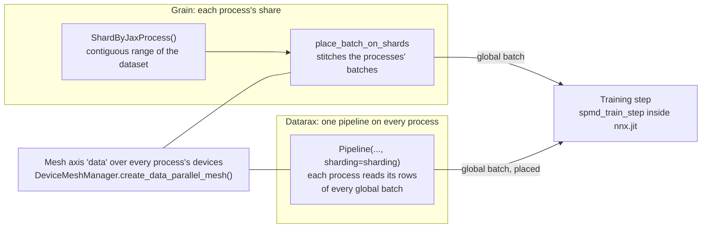

# Grain and Datarax: Process and Device Sharding Guide

| Metadata | Value |
|----------|-------|
| **Level** | Advanced |
| **Runtime** | ~1 min (CPU or GPU) |
| **Prerequisites** | [Randomness and Learnable Operators](randomness-and-learnable-operators-tutorial.md), [Sharding Guide](../advanced/distributed/sharding-guide.md) |
| **Format** | Python + Jupyter |
| **Devices** | One process per GPU, or several CPU processes, or one process on any device count; the global batch of 8 rows must split over every device |

## Overview

Data parallelism on one machine runs one process per GPU, and every process runs the same
program. Each training step takes one global batch laid out over a device mesh that spans
all the processes, and each process supplies the rows its own devices hold.

Grain and Datarax decide those rows differently. A Grain loader reads its process's share of
the dataset (`ShardByJaxProcess`), and the process's batches are stitched into the global
batch, so which records share a global batch depends on how many processes run. A Datarax
pipeline is the same on every process: given a `sharding` over the mesh, each process reads
only its rows of every global batch, so each global batch is the batch one process would
serve, whatever the process count. This guide runs both, as one process or as several.

## What You'll Learn

By the end of this guide, you will be able to:

1. Build one Datarax `Pipeline` with a `sharding` over a mesh that spans processes, and run it
   as one process or as several
2. Say which rows of a global batch each process reads, beside Grain's `ShardByJaxProcess`
3. Show that a pipeline's global batches and per-record draws do not depend on the process count
4. Feed a data-parallel training step straight from `for batch in pipeline`

## Coming from Google Grain?

| Grain | Datarax |
|-------|---------|
| `ShardByJaxProcess()` gives each process its share of the dataset, contiguous ranges | Every process builds the same `Pipeline(..., sharding=sharding)`; each reads its rows of every global batch |
| Each process batches `batch_size / process_count` rows from its share | `batch_size` is the global batch |
| `place_batch_on_shards(batch, sharding)` stitches the processes' batches into a global array | The pipeline yields the global array, already placed |
| A global batch's records depend on the process count | A global batch is the single-process batch, row for row |
| A record's generator belongs to its draw within the process's share | A record's key belongs to its global index, the same on any process count |

## Files

- **Python Script**: [`examples/comparison/03_sharding_guide.py`](https://github.com/avitai/datarax/blob/main/examples/comparison/03_sharding_guide.py)
- **Jupyter Notebook**: [`examples/comparison/03_sharding_guide.ipynb`](https://github.com/avitai/datarax/blob/main/examples/comparison/03_sharding_guide.ipynb)

## Quick Start

### Run as One Process

```bash
python examples/comparison/03_sharding_guide.py
```

The guide uses every device the process sees; on a CPU-only machine,
`JAX_NUM_CPU_DEVICES=4` gives it four.

### Run as Several Processes

Every process runs the same program with the coordinator's address, the process count and its
own index, which the script passes to `jax.distributed.initialize`:

```python
if len(sys.argv) == 4:
    coordinator, num_processes, process_id = sys.argv[1], int(sys.argv[2]), int(sys.argv[3])
    jax.distributed.initialize(coordinator, num_processes, process_id)
```

JAX starts no processes itself, so a loop launches them. Two processes with one GPU each:

```bash
for i in 0 1; do
  CUDA_VISIBLE_DEVICES=$i python examples/comparison/03_sharding_guide.py localhost:12355 2 $i > guide_$i.log &
done
wait
cat guide_0.log guide_1.log
```

Without GPUs, two CPU processes of two devices each run the same way with
`JAX_PLATFORMS=cpu JAX_NUM_CPU_DEVICES=2` in place of `CUDA_VISIBLE_DEVICES=$i`.

### Run the Jupyter Notebook

```bash
jupyter lab examples/comparison/03_sharding_guide.ipynb
```

A notebook is one process, so it runs the single-process case.

## Key Concepts

### Which rows of a global batch a process reads

| | Grain | Datarax |
|---|---|---|
| What a process reads | Its share of the dataset: `ShardByJaxProcess()` fills `shard_index` and `shard_count` from `jax.process_index()` and `jax.process_count()`, contiguous ranges | Its rows of every global batch: the rows its own devices hold under the pipeline's `sharding` |
| Its batches | `batch_size / process_count` rows each, from its share | Slices of the global batches every process names alike |
| The global array | `place_batch_on_shards(batch, sharding)` stitches the processes' batches | The pipeline places it: `Pipeline(..., sharding=sharding)` |
| A global batch's records | Depend on the process count | The single-process batch, row for row |

`place_batch_on_shards` calls `jax.make_array_from_process_local_data`: on one process it
is one batched `device_put`; on several, each process passes the rows it loaded and JAX
assembles the global array on the sharding. A Datarax pipeline does the same with the rows
it read, and the batch it yields is already that global array.

### Background: the JAX side

Every process builds the same mesh over every device (`jax.devices()` lists all the
processes' devices) and the same pipeline. JAX holds a global array in parts, each process
seeing the rows its own devices hold (`addressable_shards`); this guide gathers one with
`multihost_utils.process_allgather` only to print it.

The outputs below are from two CPU processes with two devices each, run as above; where the
two processes print different lines, both are shown.

### Part 1: Each Process's Rows of a Global Batch

Both libraries serve batches of 8 global rows over the same data-parallel mesh. Grain's
loader on each process reads its `ShardByJaxProcess` share in batches of
`BATCH_SIZE // jax.process_count()` rows, and `place_batch_on_shards` makes them global; the
Datarax pipeline reads the whole source with the global `batch_size` and the `sharding`.
Each process prints the records its devices hold of the first global batch.

```python
class Records(grain.sources.RandomAccessDataSource):
    """``{"x", "y", "index"}`` records read by index."""

    def __len__(self) -> int:
        """Return the number of records."""
        return NUM_RECORDS

    def __getitem__(self, i: int) -> dict[str, np.ndarray]:
        """Return the record at ``i``."""
        return {key: value[i] for key, value in data.items()}


mesh = DeviceMeshManager.create_data_parallel_mesh()
batch_sharding = create_data_parallel_sharding(mesh)


def build_grain_loader(shard: grain.sharding.ShardOptions, batch_size: int) -> grain.DataLoader:
    """One epoch of ``shard``'s records, in order, in batches of ``batch_size``."""
    sampler = grain.samplers.IndexSampler(
        num_records=NUM_RECORDS, shard_options=shard, shuffle=False, num_epochs=1, seed=0
    )
    return grain.DataLoader(
        data_source=Records(),
        sampler=sampler,
        operations=[grain.transforms.Batch(batch_size=batch_size)],
    )


def grain_global_batches():
    """Grain's global batches: this process's share, stitched over every process."""
    loader = build_grain_loader(
        grain.sharding.ShardByJaxProcess(drop_remainder=True),
        BATCH_SIZE // jax.process_count(),
    )
    for batch in loader:
        yield place_batch_on_shards(batch, batch_sharding)


def datarax_pipeline(
    stages: list | None = None, sharding: NamedSharding | None = batch_sharding
) -> Pipeline:
    """One epoch of every record, in order, in global batches placed by ``sharding``."""
    return Pipeline(
        source=MemorySource(MemorySourceConfig(), data=data),
        stages=stages or [],
        batch_size=BATCH_SIZE,
        rngs=nnx.Rngs(0),
        sharding=sharding,
    )


def held_records(array: jax.Array) -> list[str]:
    """The records each of this process's devices holds of a global ``index`` array."""
    shards = sorted(array.addressable_shards, key=lambda shard: shard.index[0].start or 0)
    return [
        f"rows {shard.index[0].start or 0}-{(shard.index[0].stop or BATCH_SIZE) - 1}: "
        f"{np.asarray(shard.data).tolist()}"
        for shard in shards
    ]


def gathered(array: jax.Array) -> np.ndarray:
    """The whole of a global array, on every process."""
    return np.asarray(multihost_utils.process_allgather(array, tiled=True))


with jax.set_mesh(mesh):
    grain_first = next(grain_global_batches())
    datarax_first = next(iter(datarax_pipeline()))
for name, batch in [("Grain", grain_first), ("Datarax", datarax_first)]:
    print(f"{name} on process {jax.process_index()}: {'; '.join(held_records(batch['index']))}")
# Expected output (process 0 of two CPU processes with two devices each):
# Grain on process 0: rows 0-1: [0, 1]; rows 2-3: [2, 3]
# Datarax on process 0: rows 0-1: [0, 1]; rows 2-3: [2, 3]
```

**Terminal Output** (process 0, then process 1):
```
Grain on process 0: rows 0-1: [0, 1]; rows 2-3: [2, 3]
Datarax on process 0: rows 0-1: [0, 1]; rows 2-3: [2, 3]
Grain on process 1: rows 4-5: [32, 33]; rows 6-7: [34, 35]
Datarax on process 1: rows 4-5: [4, 5]; rows 6-7: [6, 7]
```

Gathered, each library's first global batch can be set beside the batch one process serves:
Grain's single-shard loader with the global batch size, and the Datarax pipeline without a
`sharding`.

```python
one_process_grain = next(iter(build_grain_loader(grain.sharding.NoSharding(), BATCH_SIZE)))
one_process_datarax = next(iter(datarax_pipeline(sharding=None)))
grain_global = gathered(grain_first["index"])
datarax_global = gathered(datarax_first["index"])
grain_is_one_process_batch = np.array_equal(grain_global, np.asarray(one_process_grain["index"]))
datarax_is_one_process_batch = np.array_equal(
    datarax_global, np.asarray(one_process_datarax["index"])
)
print(f"Grain's first global batch:   {grain_global.tolist()}")
print(f"Datarax's first global batch: {datarax_global.tolist()}")
print(f"Grain's is the one-process batch: {grain_is_one_process_batch}")
print(f"Datarax's is the one-process batch: {datarax_is_one_process_batch}")
# Expected output (two processes; on one process both are the one-process batch):
# Grain's first global batch:   [0, 1, 2, 3, 32, 33, 34, 35]
# Datarax's first global batch: [0, 1, 2, 3, 4, 5, 6, 7]
# Grain's is the one-process batch: False
# Datarax's is the one-process batch: True
```

**Terminal Output** (the same on both processes):
```
Grain's first global batch:   [0, 1, 2, 3, 32, 33, 34, 35]
Datarax's first global batch: [0, 1, 2, 3, 4, 5, 6, 7]
Grain's is the one-process batch: False
Datarax's is the one-process batch: True
```

### Part 2: A Record's Randomness Does Not Depend on the Process Count

Datarax keys each record's randomness on its epoch, its draw and its global index
(`per_record_keys`), and every process names the same global batches, so the noise a record
receives on several processes is the noise it receives on one. The pipeline with a `sharding`
and the one without both add noise to every record of an epoch; gathered, the two agree
record for record. Grain's generator belongs to the draw within each process's share, so a
different process count draws differently.

```python
def add_noise(element, key):
    """Add Gaussian noise drawn from this record's own key."""
    x = element.data["x"]
    return element.update_data({"x": x + NOISE_SCALE * jax.random.normal(key, x.shape)})


def noise_operator() -> ElementOperator:
    """A stochastic operator with a fixed base key."""
    return ElementOperator(
        ElementOperatorConfig(stochastic=True, stream_name="noise"),
        fn=add_noise,
        rngs=nnx.Rngs(noise=0),
    )


def noise_by_record(batches, gather) -> np.ndarray:
    """Return the noise each record received, indexed by record."""
    noise = np.zeros_like(features)
    for batch in batches:
        batch_index = gather(batch["index"])
        noise[batch_index] = gather(batch["x"]) - features[batch_index]
    return noise


with jax.set_mesh(mesh):
    noise_across_processes = noise_by_record(datarax_pipeline([noise_operator()]), gathered)
noise_on_one_process = noise_by_record(
    datarax_pipeline([noise_operator()], sharding=None), np.asarray
)
noise_independent_of_processes = np.array_equal(noise_across_processes, noise_on_one_process)
print(f"Datarax: same noise per record as on one process: {noise_independent_of_processes}")
# Expected output:
# Datarax: same noise per record as on one process: True
```

**Terminal Output:**
```
Datarax: same noise per record as on one process: True
```

### Part 3: Feed the Training Step from the Pipeline

A pipeline with a `sharding` yields each global batch already on the mesh, so the training
loop takes the batches as they come: `for batch in pipeline: train_step(model, optimizer,
batch)`. Grain's batches go through `place_batch_on_shards` first (`grain_global_batches`
above). The step this guide feeds is background: a linear regression of `y` on `x` trained
with `substrax.spmd.spmd_train_step` inside `nnx.jit`, whose gradient all-reduce across the
`data` axis follows the batch's sharding. On several processes the two libraries' global
batches hold different records, so their losses differ; both fits reach the true weights.

```python
class LinearRegression(nnx.Module):
    """One linear layer from three features to one target."""

    def __init__(self, *, rngs: nnx.Rngs) -> None:
        """Initialize the layer."""
        self.linear = nnx.Linear(3, 1, rngs=rngs)

    def __call__(self, x: jax.Array) -> jax.Array:
        """Predict the target."""
        return self.linear(x)


def mse_loss(model: nnx.Module, batch) -> jax.Array:
    """Mean squared error of the prediction against ``y``."""
    return jnp.mean((model(batch["x"]) - batch["y"]) ** 2)


@nnx.jit
def train_step(model: LinearRegression, optimizer: nnx.Optimizer, batch) -> jax.Array:
    """One data-parallel step on a global batch."""
    return spmd_train_step(model, optimizer, mse_loss, batch)


def train(global_batches, epochs: int = 10) -> tuple[list[float], np.ndarray]:
    """Train a fresh model over ``epochs`` epochs of ``global_batches()``.

    Returns the loss of every step and the weights the model ends with.
    """
    model = LinearRegression(rngs=nnx.Rngs(0))
    optimizer = nnx.Optimizer(model, optax.sgd(learning_rate=0.2), wrt=nnx.Param)
    losses = []
    with jax.set_mesh(mesh):
        for _ in range(epochs):
            for batch in global_batches():  # a pipeline's batches as it yields them
                losses.append(float(train_step(model, optimizer, batch)))
    return losses, np.asarray(model.linear.kernel[...])


grain_losses, grain_weights = train(grain_global_batches)
datarax_losses, datarax_weights = train(datarax_pipeline)
fits_reach_true_weights = all(
    np.allclose(weights, TRUE_WEIGHTS, atol=1e-2) for weights in (grain_weights, datarax_weights)
)
for name, losses in [("Grain", grain_losses), ("Datarax", datarax_losses)]:
    print(f"{name}: {len(losses)} steps, loss first {losses[0]:.4f}, last {losses[-1]:.2e}")
print(f"Learned weights: {np.round(datarax_weights.ravel(), 3)} (true {TRUE_WEIGHTS.ravel()})")
print(f"Both fits reach the true weights: {fits_reach_true_weights}")
# Expected output (two CPU processes; the converged loss varies by hardware):
# Grain: 80 steps, loss first 0.9800, last 0.00e+00
# Datarax: 80 steps, loss first 3.7473, last 0.00e+00
# Learned weights: [ 2.  -1.   0.5] (true [ 2.  -1.   0.5])
# Both fits reach the true weights: True
```

**Terminal Output:**
```
Grain: 80 steps, loss first 0.9800, last 0.00e+00
Datarax: 80 steps, loss first 3.7473, last 0.00e+00
Learned weights: [ 2.  -1.   0.5] (true [ 2.  -1.   0.5])
Both fits reach the true weights: True
```

## Architecture Diagram



## Results Summary

| | Grain | Datarax |
|---|---|---|
| What a process reads | Its `ShardByJaxProcess` share of the dataset | Its rows of every global batch |
| A global batch's records | Depend on the process count | The single-process batch, row for row |
| Randomness | Drawn within each process's share | Keyed to the global record index: the same on any process count |
| The global array | `place_batch_on_shards` on each process's batch | Placed by the pipeline's `sharding` |
| Training step | `spmd_train_step` inside `nnx.jit` | The same call |

Both run as one program on every process and feed the same step; the difference is what a
global batch holds. A Datarax run on two processes trains on the batches the same pipeline
serves on one.

## Next Steps

1. [Resumed Training Guide](resumed-training-guide.md): checkpoint the pipeline, model
   and optimizer together and resume mid-epoch
2. [Sharding Guide](../advanced/distributed/sharding-guide.md): the Datarax data-parallel
   pipeline over CIFAR-10 with throughput and memory analysis
3. [Distributed Training](../../user_guide/distributed_training.md): the SPMD and
   `pmap` paths in the user guide
4. [API Reference: Sharding](../../sharding/index.md)
